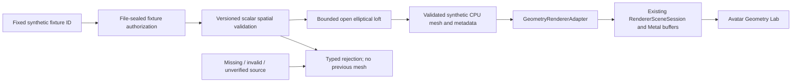

# Segment S2A — Avatar Geometry Engine & Synthetic Reconstruction Lab

## 1. Starting state and review scope

Started from clean local `audit/full-stack-stabilization-i1`, matching remote and open draft PR [#17](https://github.com/anshbalusa-ui/itchathon/pull/17), exact tip `59694077bcffc065906b6f9cbdbee5c358ea0f5c`. Its base remains `feature/catalog-bundled-garment-r3`. No newer I1 commits, uncommitted work, interrupted Git operation or existing S2A branch/PR was found. Created `feature/avatar-geometry-s2a` directly from that tip. The S2A draft targets `audit/full-stack-stabilization-i1`; no merge, cherry-pick, rebase, force-push, production rollout or repository-setting change is part of this work. #11's catalog remains integrated once through #12.

Reviewed the actual I1 audit, integration, S0, S1A, unexecuted S1B checklist, data architecture and R0/R2/R3 handoffs, plus PR #6's requirements/architecture/production plan in the separate planning-reference worktree. Current Metal implementation and newer safety decisions take precedence over PR #6's conceptual schemas, engine suggestions and full sensor-derived Segment 2 goal. This task authorizes only the synthetic S2A subset, not physical scanner approval.

Reviewed `AvatarProfileRecord`/`AvatarEntryResolver`, repository, pilot/scanner models, capture coordinator, person-depth aligner, renderer coordinate/mesh/session/asset descriptors, renderer lab, hub, build configuration and local verification runner. I1's protected unlink/exclusive-staging repairs, legacy-only preferences and correct navigation/environment ownership are unchanged.

## 2. Implemented data flow



`GeometryContracts.swift` and `GeometryKernel.swift` import Foundation only, not ARKit, Vision, UIKit, SwiftUI or camera buffers. They compile and execute as a standalone Swift program. The logical geometry domain is part of the existing app target, not an independently packaged or sandboxed library. Lab/model/viewport files are separate consumers of that domain. Everything new in this segment is `#if DEBUG`.

## 3. Input contract and source authorization

Input schema 1 declares source, metres-per-unit scale, explicit orientation, reconstruction capability, ordered synthetic axial sections and any unknown intervals. Each section has a named synthetic-surface region, independently supplied front half-width and side half-depth, a front-and-side role, observed/unavailable state and authored/insufficient/unknown quality classification. Quality is categorical, not a statistical confidence percentage.

Supported convention is right-handed, +Y up, +Z forward, floor-centred world origin, metres, scale 1, and open-section loft revision 1. Each height is measured along +Y; front extent maps to ±X, side extent to ±Z. The ellipse and its interpolated connecting surface are mathematical assumptions, not observations of a human's hidden surface or circumference.

`SyntheticGeometryGenerator.generate` accepts only `GeometryFixtureID`. The factory mints a file-private `GeometryAuthorization.reviewedFixture` value; arbitrary `GeometryInput` initializers cannot mint it. Setting source to `reviewedSynthetic` is insufficient. `GeometryKernel.validate(input:)` is an internal numeric/semantic validator for adversarial tests, not an admission service. Generation also checks authorization, and `GeometryResult` construction is file-sealed. Source `scanner` and unknown sources reject; no existing scanner capture object is accepted. This is a narrow source-code trust boundary, not cryptographic authentication against malicious modifications to the application.

No Bool supplied by a caller authorizes a scan. No images, masks, depth planes, identity, timestamps from people or customer profile values enter the long-lived contracts.

## 4. First-party synthetic fixtures

All fixtures are authored scalar geometry, not human scans, customer measurements, clothing sizes or body-image ideals. None uses an external mesh/model or service.

| Fixture | Definition and behavior |
| --- | --- |
| Synthetic surface A | Six independently authored width/depth sections; complete supported open surface |
| Synthetic surface B | Same section heights and material, independently changed lateral/depth profile; genuinely different vertex positions and silhouette |
| Synthetic missing-region rejection | Declared required unknown interval; rejects the demonstration rather than inventing or bridging it |
| Synthetic invalid geometry | Authored nonfinite section height; typed numerical rejection |
| Synthetic unverified-source rejection | Nonpersonal scanner-shaped scalar candidate with `scanner` provenance and no authorization; rejects despite plausible dimensions |

Successful fixtures have heights `[0.45, 0.62, 0.79, 0.96, 1.13, 1.30]` in the synthetic metre world. Internal profiles are defined in `reviewedFixture`; the lab never displays dimension readouts or appearance comparisons. Both successful outputs have 144 vertices, 720 indices and 240 triangles. These counts describe implementation data, not sensor quality.

## 5. Reconstruction algorithm and assumptions

Revision `open-elliptical-loft-v1` samples 24 angular positions per authored section:

- `x = frontHalfWidth × cos(theta)`
- `y = sectionHeight`
- `z = sideHalfDepth × sin(theta)`

Adjacent rings form two outward-wound triangles per angular quad. The surface is piecewise linear interpolation between known synthetic section rings. There are no extra inferred rings, endcaps, head, arms or legs. Changes in either independently provided extent directly change the generated coordinates; this is not the existing mannequin relabelled or a static model.

Normals are normalized area-weighted sums of adjacent outward face normals, accumulated in the output vertex array. This accounts for section taper without a second full temporary mesh. Angles, topology and operation order are fixed. Identical input/algorithm on the same runtime gives identical array values; cross-platform comparison should allow `1e-5` absolute Float differences. Mesh-bounds comparison allows `1e-4`, normal length tolerance is `0.01`, and triangle cross-product magnitude must exceed `1e-8`. These are numerical validity policies, not reconstruction-accuracy guarantees.

## 6. Bounded validation and failure behavior

| Resource / spatial policy | Limit |
| --- | --- |
| Synthetic section observations / reconstruction rings | 4–32 |
| Radial samples | 3–48; reviewed fixtures use 24 |
| Mesh vertices / indices | 2,048 / 12,288 |
| Checked output payload | 131,072 bytes |
| Supported position envelope | `abs(x), abs(z) <= 0.4`; `0 <= y <= 1.8`, metres |
| Independent section half-extents | 0.01–0.4 metres |
| Adjacent height gap | 0.01–0.30 metres |
| Adjacent extent change | At most the adjacent height gap on either axis |
| Active lab generation requests | One physical worker, plus one coalesced desired fixture ID |

Count limits precede arithmetic and allocation. Vertex/index multiplications and byte addition use overflow-reporting operations. One ring/section and six indices/quad are counted before reserve/allocation. Under the combined section/radial limits, the maximal requested topology is 1,536 vertices and 8,928 indices, below the independent hard ceilings. On the current SIMD layout that is 67,008 bytes of CPU/GPU mesh payload; actual Metal/driver allocation overhead is not claimed to equal payload bytes.

The kernel reserves bounded output arrays, adds no per-face arrays and accumulates normals in place. The adapter allocates one bounded renderer vertex array; indices share immutable array storage until a writer copies it. Input sections and result metadata are also bounded by the fixed reviewed factory. There is no growing cache, queue of observation buffers or external-file decoder. Driver shader/pipeline/cache memory remains an implementation/runtime cost, not included in the logical mesh payload cap.

Validation rejects unsupported schema/capability, units/scale/orientation/provenance, missing roles/regions, unavailable or insufficient observations, nonfinite and implausible numeric values, duplicates, ordering problems, discontinuity and resource overflow. Mesh validation checks finite positions/normals/bounds, bounds consistency, normalized outward normals, triangle index range, degeneracy and winding agreement. Typed `GeometryFailure` categories reach neutral user explanations. No failure fabricates defaults.

Required unknown intervals reject the whole S2A demonstration. For successful A/B results, unsupported regions above/below the authored surface, head and limbs remain explicitly unmodeled. The open ends are intentional, not holes repaired using invented anatomy.

## 7. Result metadata and physical-claim boundary

`GeometryResult` separates its schema and algorithm identity, reviewed-synthetic provenance, observed synthetic section heights, interpolation policy, unknown-region policy, unsupported regions, numerical validation status and neutral-illustration renderer capability. Its world-coordinate declaration and scale are explicit. `validate()` checks the sealed authorization and mathematical mesh contract. “Validated” means this synthetic software contract, never physical anatomy or empirical sensor accuracy.

There are no body circumferences, confidence percentages, garment tightness, drape, fit scores or size recommendations. Results never enter the legacy `FitEngine`, retailer association, `AvatarProfileRecord`, `AvatarEntryResolver` or `.savedAvatar` path.

## 8. Existing Metal integration

`GeometryRendererAdapter.mesh(from:)` validates the sealed result at the renderer consumption boundary, checks renderer payload arithmetic and maps positions/normals into existing `RendererVertex`/`RendererMesh`. `RendererAssetRole.syntheticGeometry` is distinct; the existing descriptor validator explicitly rejects that role for mannequin/garment descriptors. The R2 loader and six R3 SKU associations are unchanged.

`RendererSceneSession(geometry:)` uploads only the generated base surface, not a hidden default mannequin/garment. It reuses the same Metal shader, depth test, indexed draw, command/error handling, on-demand MTKView, camera/orbit and disposal. The existing `mannequin` property remains the scene's base render object for API compatibility; in this initializer it contains the generated mesh, with `hasSyntheticGeometry` identifying the distinct role. Generated scenes reject garment installation/replacement. Original procedural mannequin generation and default R0–R3 behavior are unchanged.

Both A/B use the same fixed sage material. The conservative existing framing envelope contains all admitted geometry at every supported orbit/aspect. Origin is unchanged; pivot is the existing `0.9m` world height. Rotation/reset changes the actual finite model matrix, not just UI labels.

## 9. CPU/GPU ownership, cancellation and lifecycle

`SyntheticGeometryGenerator` is an actor: bounded CPU calculations execute off the SwiftUI main actor. Cancellation is checked before admission, between rings, during topology generation and around final validation. Cancellation is cooperative, not a promise of immediate preemption mid-instruction.

`AvatarGeometryLabModel` owns one active async worker, selected fixture, request generation, optional CPU result and optional Metal session. Switching fixtures invalidates the request, cancels the worker and immediately disposes/clears the previous scene and CPU result. It does not mark a physically unfinished worker free; repeated switches coalesce into one latest desired fixture, started only after the old worker returns. A completion must match worker identity, request generation, selected fixture and active presentation. A producer returning a different fixture fails closed.

Background/inactivity cancels generation and releases CPU/GPU results. Foreground regenerates only the current selected fixture, preserving its orbit. Close resets selection/orbit for fresh entry; late completions cannot resurrect the scene. Weak async captures and identity-checked rendering callbacks avoid retaining or invalidating replacement owners. Native tests deliberately use a cancellation-ignoring producer to exercise these races.

`dispose()` clears vertex/index buffers, render pipeline/queue/depth references, callback, MTKView delegate and drawables. An already submitted Metal command may hold resources until its driver work completes; nil app ownership is not a claim of instantaneous driver deallocation or a measured long-term RSS plateau.

## 10. Development-only Avatar Geometry Lab

Use Debug `-fitcheck-integrated-internal` → **Avatar Geometry Lab**. There is no standalone geometry launch flag, no normal-launch entry and no persistence switch. Entry generates A; fixture buttons select/generate, with explicit Generate/Retry available. A pinned native viewport or processing/failure state sits above scrolling controls/explanations. Drag or use accessible rotate-left/right buttons, then Reset View. Large Dynamic Type uses vertically stacked alternatives.

The lab states: **“Synthetic, illustrative and not reconstructed from a real person.”** It exposes no raw spatial readouts. Missing/invalid/unverified inputs show no prior mesh, with clear unavailable/retry behavior. The hub, scanner, original Renderer Lab, synthetic catalog and legacy home remain independent destinations. No camera adapter or permission flow is constructed by geometry code.

## 11. Future verified-sensor adapter boundary — not implemented

A future separately reviewed adapter would need to produce the exact scalar `GeometryInput` spatial/region/role contract, but that alone will NOT grant authorization. It must establish all of the following before a new admission capability is added:

- Device capability and consented on-device evidence handling.
- Verified depth/frame calibration, intrinsics, units and camera/world transforms.
- Actual RGB/depth/person-mask registration and person-associated section observations.
- Subject and session continuity, independent front/side pose compatibility and consistent orientation.
- Repeatability, rejection of missing/ambiguous/occluded evidence and measured uncertainty policies.
- Evidence-backed section extents/availability and algorithm compatibility, without treating silhouette width as circumference.
- Separately reviewed provenance authorization and numerical/physical validation status.

No real adapter implementation, S1A threshold change, `AvatarCaptureCoordinator` connection or S1B approval is supplied. Existing provisional front/side candidates remain unavailable to this engine. The `scanner` source is a negative path, not an enabled integration.

## 12. Privacy, profiles and persistence

All generated geometry is first-party synthetic and in memory. No mesh files, real camera imagery, depth, masks, identifiers or body-derived observations are saved/logged/uploaded. No cloud sync, account, backend, paid service, external asset or new package exists. `AvatarProfileRecord` schema/storage, resolver readiness, safe deletion/staging and legacy preferences are unchanged.

Future personal-geometry persistence would need an independent versioned artifact contract, protected atomic publication, compatibility/integrity/size checks, migration policy, one coordinated owner, backup/account isolation and deletion review. None is activated by S2A. No new required-reason API is used by the geometry domain; existing boot time `35F9.1`, UserDefaults `CA92.1` and file metadata `C617.1` remain justified by existing code.

## 13. Verification and failure provenance

A standalone Swift executable compiled the actual Foundation-only contracts/kernel and passed deterministic A/repeat comparison, distinct A/B mesh data, 144-vertex/720-index topology, analytic bounds and typed missing/invalid/unverified rejection. It uses no XCTest, renderer, UI or scanner dependencies. Local evidence is outside Git at `/Users/anshbalusa/fitcheck-s2a-artifacts`.

The initial focused Xcode integration build failed before tests because the alternate scene initializer edit had removed the existing scene configuration/cache/orbit/appearance declarations. Those declarations were restored without changing their semantics. The next build exposed an overly complex new UI-test pixel expression; it was replaced with allocation-free loops. The two failed compile bundles remain preserved as `focused-geometry.xcresult` and `focused-geometry-corrected.xcresult`; neither is passing test evidence.

The first compiled focused run recorded 18 native passes and three UI failures. Actual exported UI hierarchy showed the generated scene labelled correctly and ready, but SwiftUI's ancestor `geometry.lab` identifier had overridden both the scene's `geometry.scene` and scrolling controls' identifiers. Removed that unnecessary ancestor identifier instead of loosening the scene/pixel assertions. This failed bundle and hierarchy remain in `focused-geometry-ui-compile-fix.xcresult` and `focused-ui-entry`. The corrected focused run and full final workflow below both passed.

### Fresh final execution — not historical I1 totals

Environment: Xcode 26.5 (`17F42`), XcodeGen 2.46.0, dynamically discovered booted iPhone 17 simulator, iOS 26.5 (`23F77`), x86_64. The full runner chose the current device rather than relying on a historical hardcoded UDID.

```sh
caffeinate -disu /usr/local/bin/python3 Scripts/verify_development.py \
  --output-root /Users/anshbalusa/fitcheck-s2a-artifacts/final-verification
```

| Fresh S2A gate | Actual result |
| --- | --- |
| Standalone real-kernel execution | Passed deterministic generation, A/B geometry difference, analytic bounds and three typed negative fixtures |
| Corrected focused native/UI run | **21/21**: 18 native and 3 UI, zero failures/skips |
| XcodeGen + clean complete Debug build/unit/UI | **267/267**: 247 unit and 20 UI, zero failures/skips/expected failures |
| Unsigned generic-iPhone SDK build | Passed; compilation, not device installation/execution |
| Normal Release simulator build | Passed; `ENABLE_TESTABILITY=NO` |
| Separate Release isolation run | **13/13**: 8 unit and 5 UI, zero failures/skips/expected failures; every requested selector actually executed |
| Actual Debug/Release Mach-O inspection | Existing and S2A development markers present in Debug positive controls and absent from normal Release |
| Reviewed vest resource integrity | Source and both Debug SDK bundles match pinned `ecc2df7e57f5a12ac89f4bd16bb51d101718780ee609a72f41c8ff1b653f7f30` |
| Release resource exclusion | Both normal and testable Release apps omit `.fitmesh` and `FitCheckDevelopmentAssets`; synthetic S2A fixtures are code, not shipped resources |
| All four actual built privacy manifests | Exactly boot time `35F9.1`, UserDefaults `CA92.1`, file metadata `C617.1`; tracking false, collection empty |
| Final native 3D visual smoke | Inspected actual final A/B surfaces, explicit unverified-source rejection and largest-text unavailable state; focused screenshots also show rotation and recovery |
| Direct actual-app launch smoke | Debug hub visibly contains Avatar Geometry Lab; actual non-testable normal Release with the integrated flag opens legacy home without the lab |
| Physical LiDAR/S1B | **NOT RUN**; no claim of physical validity |

Final evidence directory: `/Users/anshbalusa/fitcheck-s2a-artifacts/final-verification/verification-4oidsrq5`. It contains `verification.json`, exact command logs, exported test summary/tree JSON, `DebugTests.xcresult`, `ReleaseTests.xcresult` and all four derived app builds. This is local evidence, **not an uploaded GitHub artifact**.

Frozen build-input SHA-256 is `fcbd40d05cc2e9578ae9724826aace51e2d9adcc1f08f6546b6433e4bc0761fc`. The runner's before/after check and independent post-run comparison matched. Only handoff/README and external evidence work occurred after source freeze; documentation is outside this digest. Historical I1's 246/12 are not substituted for these fresh 267/13 results.

### Coverage and actual rendering evidence

- `GeometryReconstructionTests`: 9 cases cover sealed synthetic-only admission, schema/capability/scale/orientation, independent front/side mapping, analytic bounds, missing region rejection, numerical/quality/order/discontinuity failures, counts/overflow, cancellation, determinism and invalid mesh indices/normals/winding/degeneracy/bounds.
- `GeometryRendererTests`: 2 cases compare every actual Metal vertex and index element to generated CPU data, distinguish A/B from the original mannequin, preserve same material, reject garment-role confusion, check finite framing/orbit/reset and release GPU buffers/view/session ownership.
- `AvatarGeometryLabModelTests`: 7 cases cover real invalid→valid recovery, coalesced rapid switching, cancellation-ignoring stale replies, close/reopen/background races, render/producer failures, wrong-fixture replies and weak ownership.
- `AvatarGeometryUITests`: 3 Debug scenarios require actual colored viewport pixels, drag/button rotation, deterministic reset, visibly different A/B geometry, all negative fixtures without a stale scene, retry/recovery, background/repeated navigation, largest Dynamic Type and no camera-start UI. One additional Release scenario verifies no lab/scene/fixture entry on normal, internal and unknown geometry launch arguments.
- All 246 prior Debug cases remain in the full suite, including the 13 profile repository tests, all 3 I1 filesystem-race tests, scanner lifecycle/depth/capture, catalog identity/SKU/presentation and original R0–R3 renderer/Metal/UI coverage. No meaningful existing assertion was removed or weakened.

Final screenshot exports are in `final-visual-proof` and `final-large-text-proof` under the evidence root. Inspected files include A `AE2AFAFC-FA52-4385-800B-98FC030AFBD3.png`, B `5A80C6DB-2042-41BB-AC26-AFBECC919F20.png`, unverified-source rejection `56088730-08D6-4E8D-A2E8-583C16E40E7B.png` and accessible rejection `4A2EB20F-44EE-448F-9AE0-703FFF06833F.png`. Direct launches are recorded in `direct-final-debug-hub.png` and `direct-final-normal-release.png`. `focused-visual-review.json`, `final-visual-review.json` and `standalone-kernel-smoke.json` record the separate runtime/visual observations. No real person appears in any capture.

A standalone payload probe observed 32-byte `GeometryVertex` stride, 2-byte indices and **6,048 bytes** logical output payload for each reviewed A/B mesh; maximal admitted section/radial topology calculates to **67,008 bytes**. This measures representation sizes only, not resident memory, GPU driver allocation, frame rate or physical performance. Repeated native/UI rendering and resource release passed; no sustained RSS or thermal profiling is claimed. The throwaway probe initially failed to link from stdin, then compiled and executed from a temporary Swift file; this did not change the app or its successful verification inputs.

### Delivery file map

| Files | Change |
| --- | --- |
| `Sources/Geometry/GeometryContracts.swift`, `GeometryKernel.swift` | Versioned scalar input/output, sealed fixture authority, validation, deterministic kernel and negative fixtures |
| `Sources/Geometry/AvatarGeometryLabModel.swift`, `AvatarGeometryLabView.swift`, `GeometryViewport.swift` | Single-flight lifecycle owner, accessible lab and existing native MTKView gestures |
| `Sources/Rendering/GeometryRendererAdapter.swift` | Validated bounded domain→renderer CPU mesh conversion |
| `Sources/Rendering/RendererSceneSession.swift`, `RendererContracts.swift` | Minimal alternative base-mesh initializer and strict distinct synthetic role |
| `Sources/Development/InternalDevelopmentHub.swift` | Separate Debug-only geometry entry |
| `Tests/GeometryReconstructionTests.swift`, `GeometryRendererTests.swift`, `AvatarGeometryLabModelTests.swift` | Mathematical, actual-GPU and lifecycle regressions |
| `UITests/AvatarGeometryUITests.swift` | Native pixel/lifecycle/accessibility and Release isolation scenarios |
| `Scripts/verify_development.py` | Preserve all I1 gates; add S2A markers/Release selector; neutral unique directory prefix |
| `Docs/AVATAR_GEOMETRY_S2A_HANDOFF.md`, `README.md` | Actual contract, algorithm, limits, evidence, entry instructions and explicit NO-GO boundaries |


## 14. Known limitations and verdict boundary

This is a small elliptical open-section software kernel, not anatomical reconstruction. It admits a fixed reviewed first-party fixture set, not arbitrary data, imported assets or real captured observations. No mesh persistence, personalized avatar, garment adaptation or fit service exists. Numerical bounds, topology, normal orientation and simulator rendering cannot establish human-body accuracy.

Physical LiDAR/S1B, calibrated sensor association, real-person repeatability, physical GPU/thermal/power behavior, oldest supported runtime and spoken VoiceOver testing remain **NOT RUN**. No hardware or user participation is needed for the authorized synthetic software checks. No FPS, memory plateau, speedup or physical-device performance is invented.

**GO for completed S2A internal geometry software development and draft review:** deterministic generation, actual GPU-buffer data, native visual behavior, lifecycle failures, preserved regressions and full Release/privacy gates passed on the frozen source. **NO-GO for physically accurate personalized reconstruction, saved personal avatars, garment fit and consumer/commercial release.** No S2B or other segment was started.
