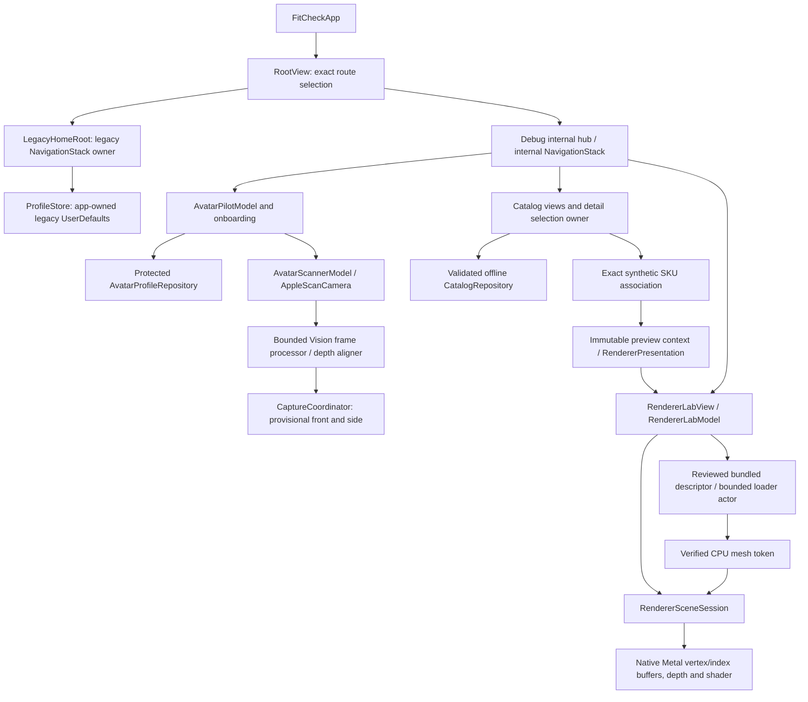

# Segment I1 — full-stack consolidation, security and stability audit

## Scope and source of truth

Audit branch: `audit/full-stack-stabilization-i1`. Checkout started clean at R3 HEAD `1401b7f19e52963cc0129844648dc1c0d124519f`, matching the fetched remote. No merge, rebase or cherry-pick was interrupted. All I1 changes are limited to the substantiated fixes, regression coverage, local verification tooling and this report. No existing branch was merged, rebased, force-pushed or retargeted.

The repository remains a commercial-intent project, not a commercially approved application. Normal launch and production Release retain the historical manual-measurement prototype. The integrated scanner/catalog/renderer experience requires Debug opt-in. A generic geometric visualization is not a personal avatar, accurate garment model, size recommendation or fit result.

Reviewed the actual S0, S1A, S1B checklist, foundation/data audits, catalog/retailer contracts, I0 and R0–R3 handoffs and their implementation/tests. PR #6's architecture and requirements were inspected remotely without importing its proposed schemas, engine suggestions, asset choices or future capabilities. Current implementation and fresh evidence take precedence over those proposals.

## Git stack and reviewability

GitHub inspection found PRs #5–#16 open drafts, with no merged timestamp. `main` remains `562173fa592330c19c04d29db2850be6018db0f4`. Every listed PR base is an ancestor of its own head. The exact base commit for a stacked row is the preceding referenced PR's full head below; #8 and #11 use the main commit above.

| PR | Current head branch | Exact head | Current base | Unique commits / changed files against base |
| --- | --- | --- | --- | --- |
| [#8](https://github.com/anshbalusa-ui/itchathon/pull/8) | `feature/avatar-s0-hardening-20261019` | `aa3e980bcd8c65f823c1ded1ba474c9dd14ece14` | `main` | 8 / 13 |
| [#9](https://github.com/anshbalusa-ui/itchathon/pull/9) | `feature/scanner-s1a-hardening-20261020` | `ae40f06e4e9449a4d0a5dfbef19ad280f67dd35a` | #8 | 1 / 18 |
| [#10](https://github.com/anshbalusa-ui/itchathon/pull/10) | `fix/foundation-audit-20261020` | `55a0c1cb3319363c84f13944c0bdaa6717d5c564` | #9 | 1 / 16 |
| [#11](https://github.com/anshbalusa-ui/itchathon/pull/11) | `feature/catalog-foundation-20261020` | `e0f7b64af82e42f240818b6aa2e4f1823adcbba1` | `main` | 1 / 17 |
| [#12](https://github.com/anshbalusa-ui/itchathon/pull/12) | `integration/avatar-scanner-catalog-20261020` | `1afe034d7376f16e6c7e993f95931ace45a0d692` | #10 | 2 / 26 |
| [#13](https://github.com/anshbalusa-ui/itchathon/pull/13) | `feature/3d-renderer-foundation-r0` | `6b30b81944966c68baca209abc32ecac0dac3666` | #12 | 1 / 16 |
| [#14](https://github.com/anshbalusa-ui/itchathon/pull/14) | `feature/catalog-3d-preview-r1` | `701ffcf1f8c7eec4fcc89db1262e6dc7bf756d51` | #13 | 1 / 13 |
| [#15](https://github.com/anshbalusa-ui/itchathon/pull/15) | `feature/bundled-3d-asset-pipeline-r2` | `c947f18e1e380325ac8879ad30c625a43e1f8bfd` | #14 | 1 / 18 |
| [#16](https://github.com/anshbalusa-ui/itchathon/pull/16) | `feature/catalog-bundled-garment-r3` | `1401b7f19e52963cc0129844648dc1c0d124519f` | #15 | 2 / 17 |

The R3 tip contains the heads of #7, #8, #9, #10 and #12–#16. It does not contain the heads of #5, #6 or #11. Earlier S0 PR #7 (`84312c56ad15c60d9bd8f2bcf81123bc5a2e5d29`) is preserved inside #8's ancestry, not missing work to cherry-pick again. PR #5's experimental scanner head and PR #6's planning head remain separate from the implementation stack.

### Independent catalog contribution

The original #11 commit is not an R3 ancestor. Its selected implementation was integrated as `f3461768b5081005c4c9458fd176d75c68e4c551`, whose parent is #10. Per-file stable patch IDs match for 13 of #11's 17 paths: both catalog documents, all six catalog source files, four unit-test files and the catalog UI tests. This is not whole-commit patch equivalence. README was adapted; the original avatar feature helper, RootView change and catalog-only privacy file did not become matching cherry-pick deltas. I0 subsequently replaced feature routing and preserved the complete manifest.

A read-only three-tree diagnostic used:

```sh
git merge-tree --trivial-merge 562173fa592330c19c04d29db2850be6018db0f4 \
  origin/feature/catalog-bundled-garment-r3 e0f7b64af82e42f240818b6aa2e4f1823adcbba1
```

It produced conflict-bearing output for `Docs/CATALOG_FOUNDATION.md`, `README.md`, `CatalogModels.swift`, `CatalogViewModels.swift`, `CatalogViews.swift`, `SyntheticCatalog.swift`, `PrivacyInfo.xcprivacy`, `RootView.swift`, `CatalogIsolationTests.swift`, `CatalogRepositoryTests.swift` and `CatalogUITests.swift`. It also proposed adding the obsolete `Sources/AvatarNext/AvatarExperienceFeatures.swift` from the independent branch. This diagnostic changes no refs, index or worktree; it is not a full rename-aware future merge guarantee.

**Decision:** do not merge #11 again. The catalog code is present once through the reviewed cherry-pick; merging the original branch would add duplicate history and conflict with later accessibility, routing, privacy, preview and vest changes. The strictly stacked current heads have no ancestry divergence requiring a merge repair now. Their current deltas match their intended segment boundaries; #8 deliberately includes the earlier #7 foundation because its base remains main.

## Component and data-flow architecture



Direct avatar/catalog launch flags select the same isolated roots without requiring hub traversal. Each selected root owns one active NavigationStack, never a nested stack for catalog/renderer. The legacy environment surrounds its entire stack so pushed editors inherit the same store. Repeating one valid flag is allowed; distinct conflicting flags and unknown renderer aliases resolve to legacy. Release resolves every internal flag to legacy. Legacy modal editors retain their sheet-local navigation stacks.

The composition boundary is `CatalogPreviewAssociation` and its immutable presentation snapshot. Low-level Metal code does not fetch catalog records or depend on `CatalogRepository`, scanner buffers or protected profiles. There is no runtime dependency cycle found. The sources still form one app target: these boundaries are source/API conventions, not independently enforced Swift package boundaries. No dependency-injection framework or speculative module split was introduced.

## Confirmed defect I1-01 — deletion check/removal race

**Impact:** unrelated directory contents could be recursively deleted at a reserved profile or staging pathname if the entry changed after its regular-file check.

PR #10 correctly clears URL's cached `.isRegularFileKey` before checking the current kind. However, the subsequent `FileManager.removeItem(at:)` was a separate recursive-capable path operation. `I1ProfileSafetyTests.testDeleteCannotRecursivelyRemoveDirectorySwappedAfterKindCheck` initially intercepted that removal, replaced the just-checked file with a marker directory and delegated the old removal. Against unchanged production source the test failed because the marker had been deleted. The scenario is confined to a UUID temporary directory.

**Repair:** keep the fresh kind check and existing missing/I/O semantics, but perform removal with `unlink(2)`. That kernel operation does not recurse into a directory substituted after the check. The existing filesystem failure seam was narrowed to an injected `@Sendable` file-removal closure; obsolete recursive FileManager mocking was removed. The production default calls the same nonrecursive helper used by the race regression.

The final regression always asserts that the replacement really occurred, requires an I/O failure rather than false deletion success, and verifies the marker bytes survived. It cannot pass merely because the old FileManager interception was bypassed. Existing static/cached-directory, corruption, schema, failed-publication, protected-staging, backup and explicit-recovery assertions remain intact. The existing injected deletion-failure test still requires profile preservation and a surfaced permission error.

## Confirmed defect I1-02 — unrelated legacy preference reads

**Impact:** opening only the synthetic catalog or renderer experience unnecessarily initialized the app-global `ProfileStore`, whose initializer reads saved manual body/garment/chart preferences. The renderer did not consume those values, but the app-shell ownership defeated the intended minimum-data boundary.

Source evidence was `FitCheckApp`'s eager `@StateObject` plus `.environmentObject(store)` before route selection. A temporary abstract initialization trace reproduced the read on catalog-only launch. After moving the StateObject and environment injection into the legacy-only `LegacyHomeRoot`, the same instrumented catalog was visibly open with no trace entry; normal legacy launch remained a positive control and emitted the entry. No values, dimensions or identifying data were logged. Debugger attachment was attempted first but timed out; no debugger-derived state is claimed.

The temporary trace and launch hook were removed before final verification. `ProfileStore`'s persistence format, preference keys and read/write methods are unchanged. Existing manual-flow UI coverage now cold-launches the internal catalog between save and legacy rehydration, then retains its saved body/favorite/candidate, cancel-without-save and explicit deletion assertions. This checks preservation across the changed root ownership; the runtime trace and source boundary, not unchanged bytes alone, establish absence of the unnecessary read.

The first full I1 run then exposed an integration regression in the initial ownership repair: 243 tests passed, but My Body navigation exited the app and the existing manual UI test failed. Its actual recording showed SpringBoard after the tap, and the crash stack contained `EnvironmentObject.error()`. Applying the environment only below the shared NavigationStack did not supply it to the pushed editor. The final `LegacyHomeRoot` therefore owns the legacy stack and applies the environment around that stack; internal routes retain their own single active stacks. The unchanged manual assertions plus the new catalog round trip passed in a focused real UI run, one test with zero failures/skips. This was an I1 intermediate regression found and repaired, not a newly attributed R3 defect.

## Confirmed defect I1-03 — staging substitution and cleanup ownership

**Impact:** an entry created after abandoned-staging cleanup could be followed or overwritten by the protected Data write. An isolated real-repository probe inserted a symlink at that boundary: save reported success and the unrelated synthetic marker bytes were overwritten. Native iOS regressions separately reproduced redirected symlink writes and replacement of a different regular file, while the deletion-race positive control passed: one passed / two failed before this repair.

**Repair:** request `.withoutOverwriting` together with `.completeFileProtection` for staging creation. The installed SDK exposes both options. Creation now occurs before the owned-publication cleanup block: failure to create does not let cleanup claim and delete the colliding entry. Backup exclusion and same-directory atomic publication still happen only after a completed protected staging write; their failures still clean the created staging file and preserve the committed destination.

Both regressions force the substitution, require an I/O failure, preserve the prior committed profile bytes, preserve either the unrelated symlink target or the other regular staging entry, and explicitly remove only the fixture-owned replacement before proving a clean save/reload retry. All 16 repository/race tests pass after repair. The standalone symlink probe now reports rejected save / preserved marker, and the actual repository recovery executable still passes.

A failed low-level write may leave protected unpublished staging for ordinary next-operation recovery; it is never decoded as a profile. This narrow creation/cleanup fix does not establish multi-actor transactions or make the later path-based metadata/publication sequence an arbitrary hostile-filesystem importer. The coordinated-owner and app-container trust limitations below remain.

## Profile persistence and readiness review

- Save validates before mutation, exclusively creates complete-protection staging data, applies backup exclusion before same-directory atomic rename and preserves the prior committed destination on publication failure. Creation collisions are not overwritten or cleaned as owned files.
- Load discards unpublished staging, checks the schema header before current decoding, preserves corrupt/unsupported committed bytes and distinguishes genuine I/O failures from missing data.
- Cleanup/deletion now combine the existing fresh-kind policy with nonrecursive removal. Logical deletion is not forensic erasure or revocation of historical backups.
- Default renderer compatibility still rejects every personal profile. Structurally eligible metadata is not scan validation, approved geometry or a displayable personalized avatar. Generic Metal fixtures do not change that resolver.
- The store is app/device scoped, not account isolated. Independently constructed actors share one pending filename and are not a transaction coordinator. Current capture does not write a profile; no current overlapping writer was reproduced. A future capture/sync/account owner must establish one coordinated repository and explicit namespaces/migration first.
- Profile load and later metadata/publication operations remain Foundation/path-based in an app-owned container. Exclusive leaf creation is not a general FD-anchored hostile-filesystem transaction; external input bounds and broad special-file policies remain outside the validated storage contract. Do not infer the asset loader's separate FD policy applies to profiles.

A throwaway executable compiled the actual profile record/repository sources outside XCTest. It passed real temporary-filesystem round trip, abandoned staging recovery, directory preservation, cold-owner reload, explicit recovery and logical deletion. It did not test iPhone keybag protection, actual backup behavior or forensic destruction.

## Scanner ownership, continuity and privacy

The repaired S1A path remains separate from the historical manually marked legacy AR scanner. `AppleScanCamera` owns the current ARKit preview/session. Preview teardown and callbacks verify camera identity; permission and analysis replies verify attempt generations. Vision work remains one bounded physical job rather than a frame backlog. The depth adapter preserves same-frame/calibration/orientation metadata and evaluates person-associated regions, not scene-wide background depth alone.

Existing regressions cover stale preview dismantling, replaced-camera callbacks, delayed permission/results, cancellation/retry, background interruption, observation gaps, tracking/multiple-person ambiguity, camera/context changes, undefined orientation axes and implausible facial placement. Continuity invalidation starts a new front instead of reusing an unreliable prior capture. Evidence remains temporary and provisional; no candidate pair is saved or promoted into body geometry.

Catalog and renderer construction contain no camera initialization, AR session start, profile-save call or scan-buffer dependency. The only camera entry is explicit scanner navigation/start. No raw frame/depth/mask/landmark persistence, upload client or sensitive logging sink was found. Physical permission behavior, RGB/Vision/depth registration, ordinary front/side usability, missed people, app-switcher privacy, framework-buffer retention and thermal behavior remain unverified; use the exact S1B checklist after separately authorized hardware access.

## Catalog and exact preview authorization

The offline repository validates schema, retailer-scoped identity, stable SKU identity, option membership, availability, integer-minor-unit prices/currencies and finished-garment measurement provenance. Detail presentation rejects a foreign product or SKU even when option names match, clears old selection/preview on changes and uses request generations to reject stale product/variant responses. Missing prices, measurements, media and inventory knowledge remain missing.

All approved rows use retailer `sample-studio`, synthetic source/revision/reference `synthetic` / `sample-v1` / `local-synthetic-fixture`, matching listed available variants and exact selected responses:

| Product | Exact SKU | Color / size ID | Geometry |
| --- | --- | --- | --- |
| `everyday-tee` | `everyday-navy-small` | `navy` / `small` | Reviewed procedural shirt |
| `everyday-tee` | `everyday-navy-medium` | `navy` / `medium` | Same procedural shirt |
| `weekend-tee` | `weekend-sage-small` | `sage` / `small` | Reviewed procedural shirt |
| `weekend-tee` | `weekend-sage-medium` | `sage` / `medium` | Same procedural shirt |
| `geometric-vest` | `geometric-vest-navy-small` | `navy` / `small` | Exact reviewed bundled vest |
| `geometric-vest` | `geometric-vest-navy-medium` | `navy` / `medium` | Same bundled vest |

Category, renderer capability, material, asset role/revision, provenance, internal-use policy and resource compatibility remain checked. Cream, discontinued Archive, out-of-stock/unknown variants, altered provenance, foreign identities and unsupported descriptors fail closed. Titles, color names, size labels and filenames cannot authorize a preview. Size selection never scales either geometry source.

Provenance fields and SHA-256 are consistency inputs, not cryptographic publisher authentication or commercial rights. No external catalog adapter exists. A future retailer integration must independently establish authenticated source/identity and asset-display/distribution authorization; it cannot mark real input synthetic and borrow these internal rows.

## Metal scene and asynchronous resource ownership

The renderer remains MetalKit/Metal: actual indexed meshes, perspective, depth buffer and the first-party Lambert shader. No RealityKit or 2D fallback was found in the rendering module. SceneKit remains intentionally used by the legacy camera and S1A's ARSCNView preview; that does not make it the mannequin renderer. PR #6's RealityKit/SceneKit suggestion predates R0's actual simulator-driver investigation and final Metal implementation.

Finite bounded orbit transforms, aspect/projection handling, camera reset, garment visibility and material changes remain separate from scene creation. Simple appearance changes reuse uploaded buffers. Product snapshots lock geometry and selected supported material; the independent Lab retains its explicit asset/material controls.

`RendererLabModel` owns one active session and a cancellable asset task. Completion requires the current generation, live presentation and matching scene identity; callbacks capture weak owners. Source changes clear the previous garment before loading. Failure leaves the mannequin and a recoverable error, not an unlabelled procedural substitute. Background cancels pending work and releases the scene; foreground recreates only the current approved source. Close clears the decoded garment cache and releases GPU/view ownership. A cache may remain across a temporary background suspension; it does not survive close.

Existing native regressions compare the loaded mesh to actual Metal buffer contents, verify finite transforms, scene identity, stale task rejection, locked product controls, missing/invalid load recovery, repeated open/close and released weak ownership. UI regressions retain real viewport-pixel checks for silhouette, material, rotation/reset and show/hide. Those are stronger than a Boolean selection test, but are not a physical GPU leak or performance certification.

## Bounded file-backed pipeline and integrity

Only `DevelopmentAssets/FitCheckGeometricVest.fitmesh` is registered. Its descriptor remains the exact first-party, locally owned, nonpersonalized, internal-development garment, revision/schema 1, capability `fitcheck.r0.metal.v1`, solid-color Lambert material, one triangle submesh, right-handed `+Y` up / `+Z` forward, metre units, floor-centred origin and scale 1.

Pinned SHA-256:

```text
ecc2df7e57f5a12ac89f4bd16bb51d101718780ee609a72f41c8ff1b653f7f30
```

The loader validates the registered descriptor before resolving its fixed child directory/leaf. Directory `open` and leaf `openat` use no-follow/nonblocking/close-on-exec flags; `fstat` rejects nonregular files and bounds size before decoding. The bounded read detects growth beyond the cap. Digest verification precedes JSON decoding. Cancellation is checked around read, decode and validation.

| Limit or reviewed content | Value |
| --- | --- |
| Maximum file data | 65,536 bytes |
| Maximum vertices | 1,024 |
| Maximum indices | 6,144 |
| Maximum checked vertex/index payload | 45,056 bytes |
| Reviewed fixture file | 16,645 bytes |
| Reviewed vertices / indices / triangles | 108 / 108 / 36 |
| Reviewed requested vertex / index payload | 3,456 / 216 bytes |

Geometry validation checks exact metadata/field schema, finite positions/normals, authored bounds, normal length, index range/conversion, triangle topology, degeneracy and winding. Size multiplication/addition checks overflow before Metal allocation. JSONDecoder may allocate bounded CPU arrays before the count check; this is acceptable only for the byte-capped, digest-pinned reviewed bundle, not a claim of general untrusted mesh parsing. The actual GPU allocation size and driver caches are not the logical payload byte counts.

The file's product/variant fields remain nil. R3's independent exact association authorizes only the two fictional vest SKU illustrations; the mesh descriptor itself does not grant retailer rights. No importer, document picker, external URL, downloaded texture or remote conversion service was introduced.

## Privacy, development isolation and documentation discrepancies

Source review found no new network client, analytics, advertisement, account service, credentials or scan-data sink. The new foundation persists only derived personal metadata in its protected repository; legacy measurement preferences are intentionally preserved. Generic mesh resources are first-party synthetic geometry with no personal scan input. No personal image or diagnostic dump is committed.

The manifest is unchanged: boot time `35F9.1` for in-app elapsed-time use, UserDefaults `CA92.1` for app-owned preferences, and file metadata `C617.1` for app-owned resource metadata checks. Source usage includes `systemUptime`, UserDefaults and `fstat`/URL resource attributes. Tracking is false and collection is empty. This is not App Store privacy approval or a claim that local derived/body metadata are nonsensitive.

`#if DEBUG` gates the experimental scanner/catalog/renderer and their UI. The protected metadata foundation remains ordinary source but is not opened by the legacy route or catalog/renderer. XcodeGen's explicit build phase copies only the reviewed mesh for Debug and removes only its own generated resource for other configurations. A successful Release build is not considered isolation proof: actual bundles, Mach-O contents and runtime route tests are required below.

Historical documents are segment-scoped evidence, not current feature counts. S0's old feature helper was replaced by I0's resolver; I0's two-reason manifest predates R2's file metadata declaration; R1's three-product catalog predates R3's vest. README's old device-installation/qualitative accuracy paragraph is now explicitly labelled historical legacy scanner context. It does not validate the newer S1A scanner. “Single navigation owner” describes internal routing, not a ban on legacy modal editor stacks.

## Reproducible verification and CI boundary

`Scripts/verify_development.py` is a Python 3.9+ standard-library local runner. It discovers an available iPhone simulator or validates an explicit UDID, creates a unique external evidence directory, generates the project, runs a clean complete Debug build/unit/UI suite, compiles the unsigned iPhone SDK target, builds normal Release without testability override, then runs the separate Release isolation artifact with testability enabled only there.

It extracts xcresult summary/tree sequentially to avoid the installed tool's SQLite-cache race; requires all cases passed with no skips/expected failures; records native/UI counts; and verifies every requested Release selector actually executed. It checks normal Release testability, all four app manifests, reviewed source/Debug fixture digests, Release resource exclusion, Debug positive markers and all normal-Release Mach-O negative markers. A build-input digest detects source changes during the run. `--inspect-derived` explicitly reports existing-artifact inspection rather than fresh test proof.

No GitHub Actions workflow or repository CI directory was present; the API reported zero workflows. No cloud CI, spending, service connection, credential or recurring job was enabled.

Before the full run, the tool was exercised against preserved R3 artifacts, explicitly as historical-artifact smoke. Controlled copies demonstrated rejection of a nonexecuted Release selector, leaked Release mesh, missing file-metadata reason, leaked development binary marker, missing fixture and modified fixture digest. Those are tool checks, not additional app tests. Their disposable inputs/results remain outside Git.

### Interrupted-session recovery

On October 22, recovery found the intended I1 branch still at R3 `1401b7f19e52963cc0129844648dc1c0d124519f`, with all three repairs, tests, runner and this audit present as uncommitted work. Nothing was staged, no Git operation was active, and no remote I1 branch or I1 PR existed. A source/document/test tar snapshot and binary Git patch were saved outside the checkout before further work. No reset, cleanup, checkout or replacement implementation was used.

The final-verification directories `i1-vk9d0uwn` and `i1-lah8vahn` contain incomplete Debug result bundles without `Info.plist`; `xcresulttool` rejected both. Neither had a completed verification report, and no verifier or `xcodebuild` process survived. Their partial logs are not passing evidence. The earlier failed full result and focused 14-, 16- and 1-test passing results were independently recovered with `xcresulttool`. A replacement full workflow uses a new unique directory under `recovery-verification-20261022`, preserving every earlier bundle.

Read-only GitHub checks during recovery confirmed R3's expected head, the unchanged main head, open draft stack, zero Actions workflows, allowed merge/squash/rebase methods, disabled automatic branch deletion, empty main rules and unprotected main. No repository setting was changed. Local recovery provenance is recorded in `recovery-state-20261022.json`; local evidence is not a committed GitHub artifact.

The recovered source still uses nonrecursive unlink and exclusive protected staging creation outside the owned-publication cleanup block. The corrected legacy root owns its NavigationStack and supplies the environment around it. No temporary preference-read hook or source logging remains. Recompiled real-repository smoke executables again passed round trip, unpublished-stage recovery, directory preservation, cold-owner reload and deletion; the staging symlink probe rejected saving and preserved its unrelated synthetic marker.

Recovery's first complete run, `i1-j4o9hpka`, correctly failed with 245 passed / 1 failed / zero skipped: `CatalogUITests.testProductNavigationAndAccessibleColorSizeSelection` timed out synthesizing a swipe. Exported event snapshots place the swipe at 13:52:15; `pmset` records clamshell sleep at 13:52:16, followed by maintenance sleep/wakes. All 229 unit cases, the legacy manual flow and the other 16 UI cases passed. This is retained as a failed run, not silently combined with a focused retry. The unchanged complete workflow was rerun under `caffeinate -disu`; no product code, test assertions or selectors were changed. Preventing idle sleep cannot prevent a forced lid-close sleep.

## Fresh execution evidence

Current completed I1 observations:

| Check | Observed result |
| --- | --- |
| New directory-swap regression against unchanged production source | Failed: unrelated marker removed |
| Repaired repository and all existing repository regressions | 14 passed, zero failures/skips |
| Standalone actual repository executable | Passed real temporary-filesystem recovery/deletion scenarios |
| Instrumented catalog before root repair | Unnecessary legacy preference initialization observed |
| Staging ownership regressions before repair | 1 positive control passed / 2 failed; symlink redirection and other regular entry replacement reproduced on iOS |
| Final focused repository/race suite | 16 passed, zero failures/skips; previous committed bytes, colliding entries and explicit retry preserved |
| Final standalone staging probe | Save rejected; unrelated marker preserved |
| Corrected catalog visibly open / normal legacy positive control | No initialization entry / expected entry |
| Local verification rejection smoke | All six controlled invalid conditions rejected |
| Initial full I1 Debug run | 243 passed / 1 failed; existing manual navigation exposed the intermediate environment-scope regression |
| Corrected legacy pushed-editor/persistence UI scenario | 1 passed, zero failures/skips; all existing assertions retained |
| First complete recovery Debug run | 245 passed / 1 failed / zero skipped; host sleep interrupted XCTest swipe synthesis; failure and power/event diagnostics preserved |
| Final XcodeGen and clean complete Debug build/test | Passed: 246/246, comprising 229 unit and 17 UI; zero failures/skips/expected failures |
| Final profile safety coverage within full Debug suite | All 13 existing repository cases and 3 forced-race cases passed, including collision preservation and clean retry |
| Final integrated navigation and legacy persistence | Passed full UI scenarios: scanner unsupported/cancel/reopen, independent catalog selections, renderer navigation/background, pushed legacy editors and cold-catalog persistence round trip |
| Unsigned generic-iPhone Debug SDK compilation | Passed; actual iPhone bundle fixture and privacy declarations inspected |
| Normal Release simulator build | Passed with `ENABLE_TESTABILITY=NO`; separate Release test artifact alone used testability override |
| Release isolation suite | 12/12 passed: 8 unit and 4 UI; zero failures/skips/expected failures; every requested selector executed |
| Actual Debug/normal Release binary inspection | All specified development positive controls present in Debug and absent from every inspected normal-Release Mach-O |
| Reviewed resource digest and Release exclusion | Source, Debug simulator and iPhone fixture SHA-256 match the pinned digest; neither Release bundle contains a `.fitmesh` or development asset directory |
| Privacy manifest inspection | All four built apps retain exactly `35F9.1`, `CA92.1`, `C617.1`, tracking false and empty collection declarations |
| Visual evidence and direct runtime smoke | Inspected final integrated hub/scanner/catalog and native vest/rotation/procedural-switch screenshots; separately launched Debug hub and normal Release with internal flag, observing hub / legacy home respectively |
| Physical device availability | Known phone unavailable; no hardware execution |

Final fresh evidence is local at `/Users/anshbalusa/fitcheck-i1-artifacts/recovery-verification-20261022/i1-27d7kb0u`: `verification.json`, command logs, exported test summary/tree JSON, `DebugTests.xcresult`, `ReleaseTests.xcresult` and both SDK/Release build bundles. The completed invocation was:

```sh
caffeinate -disu /usr/local/bin/python3 Scripts/verify_development.py \
  --simulator D5BE86CA-76FC-4C6A-BD88-5D29FFF910F5 \
  --output-root /Users/anshbalusa/fitcheck-i1-artifacts/recovery-verification-20261022
```

The runner's before/after build-input SHA-256 and an independent post-run comparison agree: `3a80c9dc135c6c1f34c16b432aff3bc042f81afd231713270ad8e11405a07f76`. This fingerprints the runner, project configuration, source, tests and development asset; later audit/README edits do not alter those build inputs. Historical R3's 243 Debug and 12 Release results are not substituted for this I1 run.

Visual exports remain local in `recovery-final-integrated-ui-20261022` and `recovery-final-vest-ui-20261022`; direct runtime screenshots are `recovery-direct-hub-20261022.png` and `recovery-direct-normal-release-20261022.png`. These were actually inspected, not inferred from screenshot attachment names. The exact Navy S vest, rotated 3D geometry and subsequent procedural T-shirt are visibly distinct and retain honest generic-fixture labels. `recovery-filesystem-smoke-20261022.json` records the separately compiled real-repository checks. The failed run, power events, prior interrupted bundles and safety snapshot remain preserved. None of these external artifacts is claimed to be uploaded to GitHub.

## Resource and hardware observations

The standalone filesystem smoke and focused native regressions ran real code, not mocks of saved metadata. The resource pipeline's requested payload and count bounds are explicit above. Existing native ownership tests and actual repeated-navigation UI scenarios are part of final verification, not evidence of a sustained RSS plateau or zero driver leaks. No FPS, thermal, prolonged-memory or physical GPU result is invented. Debugger attachment timed out; no usable debugger/memory trace was obtained.

The available simulator runtime is iOS 26.5 (`23F77`) on x86_64, Xcode 26.5 (`17F42`), XcodeGen 2.46.0. iOS 17 deployment compilation does not establish oldest-supported-runtime behavior. Physical LiDAR/GPU, lock/unlock/keybag protection, actual backup exclusion, OS app-switcher capture privacy, extended memory/thermal behavior and manual physical VoiceOver remain NOT RUN.

## Changed files and regressions

- `Sources/AvatarNext/AvatarProfileRepository.swift`: nonrecursive unlink, narrowly typed removal injection and exclusive protected staging creation with owned-publication cleanup; schema, protection, atomic publication and routing preserved.
- `Sources/FitCheckApp.swift`, `Sources/Views/RootView.swift`: legacy-only preference ownership without changing navigation routes or legacy storage.
- `Tests/I1ProfileSafetyTests.swift`: forced directory deletion race, staging symlink redirection and foreign regular-entry preservation/error/retry regressions.
- `Tests/AvatarProfileRepositoryTests.swift`: migrate the existing permission-failure injection, retaining its meaningful assertions.
- `UITests/ManualFlowUITests.swift`: preserve saved legacy records across a catalog-only cold launch and return.
- `Scripts/verify_development.py`: reproducible local workflow and actual artifact/selector gates.
- `README.md`: audit/verification links, host-awake invocation guidance and explicit historical legacy-device wording.
- `Docs/AVATAR_S0_HANDOFF.md`: retain historical evidence while linking the current ownership and staging corrections.
- `Docs/FULL_STACK_I1_AUDIT.md`: consolidated findings and proposed review sequence.

No scanner algorithm, catalog SKU registry, renderer engine, asset descriptor, mesh bytes, profile schema, privacy reason, production rollout or backend feature changed. Temporary initialization tracing, throwaway executables, result bundles and synthetic screenshots are not deliverables in Git.

## Compact risk register

| Classification | Evidence / current status | Required next action |
| --- | --- | --- |
| Security/privacy blocker — repaired | I1-01 reproduced deletion after a path-to-directory swap; nonrecursive removal and forced-swap regression now preserve it | Review repair; retain both the old cached-kind and new race regressions |
| Security/privacy boundary — repaired | I1-02 observed legacy preference initialization on catalog-only launch | Keep preference owner scoped to legacy root; preserve source boundary and cold-launch checks |
| Security/privacy blocker — repaired | I1-03 reproduced staging redirection/foreign-entry overwrite; exclusive protected creation and ownership-aware cleanup preserve prior data | Retain both collision regressions and explicit recovery; do not infer concurrent-writer coordination |
| Correctness blocker before concurrent writers/accounts | Shared pending pathname, per-instance actor serialization, app-global/device-scoped records | Establish one coordinated owner and account migration/isolation before adding writers or sync |
| Security/privacy limitation | Profile I/O is app-container/path based; external hostile profile ingestion and special-file policies were not validated | Do not add untrusted profile imports; separately review bounded FD policy if storage trust expands |
| Hardware validation blocker | S1B physical cases, scan registration/usability, GPU/thermal/keybag/backup behavior NOT RUN | Obtain suitable hardware and separately authorize the existing checklist; no personalized-geometry approval |
| Release blocker | Shipping route is still the unvalidated historical manual-measurement prototype, not the intended consumer product | Separate consumer rollout, legacy-data, privacy and product-claim review |
| Development quality gate — passed | Final frozen-source generation, full Debug/UI, generic SDK, normal Release, Release isolation, bundle inspection and visual smoke passed | Retain local evidence; rerun on any changed build inputs or proposed merge result |
| Future functionality / rights blocker | Only six fictional associations and one internal first-party mesh; no real retailer authorization, licensed assets, accounts or backend | Require independent commercial rights, authenticated product/asset mapping and ingestion review |
| Informational limitation | One app target; no enforced module/package isolation, physical VoiceOver or oldest-runtime proof | Preserve current narrow APIs; validate runtime/accessibility and separate modules only when requirements warrant it |
| Integration/review risk | #11's original history is not the cherry-pick ancestry; read-only merge diagnostic shows conflicts and obsolete helper reintroduction | Review its contribution but do not merge it again |
| Informational review-governance risk | Repository allows merge, squash and rebase; main's branch-rules API is empty and classic protection reports “Branch not protected” | Owner should decide enforced reviews/gates before production consolidation; no repository settings were changed |

## Proposed safe review and eventual merge sequence — not executed

Read-only repository settings confirm merge commits, squash and rebase are allowed, with automatic head-branch deletion disabled. The main branch rules endpoint returned an empty list and classic protection returned HTTP 404 “Branch not protected”. These are technical permissions, not authorization to merge. No CI or server-enforced review gate was added; the owner must approve any governance change separately.

Before production consolidation, recommend owner-approved main protection requiring at least one independent approving review, stale-approval dismissal after new changes, and required successful Debug/unit/UI, generic SDK, normal Release, isolation and bundle/privacy/hash checks on the proposed merge result. Required CI gates need a separately approved macOS runner/workflow and evidence retention policy; this local runner is not an existing hosted status check. Do not enforce a nonexistent check or enable paid/cloud services without approval.

1. Review #8 as the hardened foundation, including the #7 ancestry it already contains. Keep #5 and #7 as historical context; do not add their code again. Review #6's planning separately without treating its proposed geometry/fit APIs as implemented.
2. Review #9, then #10, preserving camera, continuity and deletion regressions. #10's original cached-kind repair remains necessary alongside I1's atomic nonrecursive removal.
3. Review #11 as the independent catalog contribution and compare the selected cherry-pick evidence, but do not merge that branch into main or the stack a second time. Historical PR closure/supersession requires owner approval, not an I1 action.
4. Review #12's integration/conflict decisions, especially complete privacy declarations, distinct launch routes, accessibility and data isolation. Then review #13, #14, #15, #16 and I1 in dependency order.
5. Only after explicit approvals, prefer history-preserving merges/fast-forwards for this existing stack. After each approved parent reaches main, an authorized maintainer can retarget the next child to main and recheck its ancestry and delta. Squashing or rebasing a parent without coordinated child adjustment loses those ancestry anchors and can make already-reviewed changes reappear. No such operation is performed here.
6. A later consolidated tip-to-main review PR may help final system review, but would be large and must reference the individual reviews rather than reimplement or cherry-pick their code. Choose either the approved history-preserving sequence or an explicitly coordinated consolidation, not both plus #11.
7. Before each authorized merge, fetch again, verify base/head identities and patch inclusion, inspect routing/privacy/resource conflicts, and rerun the full local workflow on the actual proposed result. Confirm the catalog contribution lands once and every repair/regression remains present. Preserve historical test reports as historical; use fresh source/artifact evidence for the final candidate.

No PR base, merge state or existing ancestry was changed by I1.

## Verdict at this audit revision

**GO for the internally integrated development stack and draft I1 review:** all three substantiated repairs are present, the complete frozen-source workflow passed, actual visual/runtime evidence was inspected, and legacy persistence plus production isolation remain covered. This is not authorization to merge or enable a consumer rollout.

**NO-GO for commercial release, accurate scanning, personalized geometry, real retailer assets or physical fit.** Hardware, rights, product rollout and account/data-ownership limitations are not resolved by synthetic simulator rendering.
