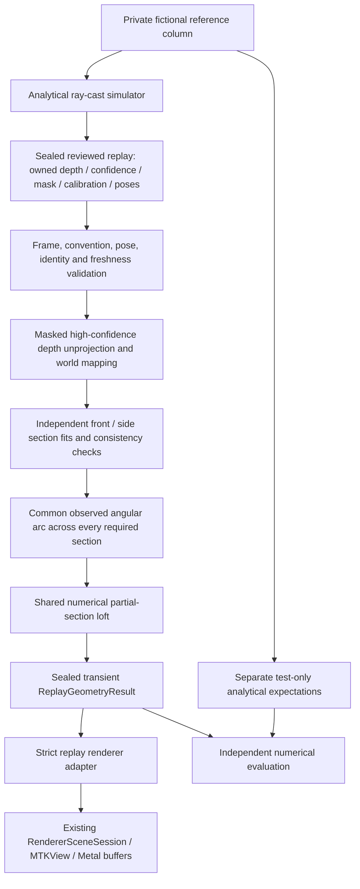

# S2C — Synthetic LiDAR replay and spatial reconstruction

## 1. Review baseline and scope

- Repository: `anshbalusa-ui/itchathon`.
- Source/base branch: `feature/avatar-artifact-storage-s2b`, draft [PR #19](https://github.com/anshbalusa-ui/itchathon/pull/19).
- Verified local and remote base commit: `a00f0cb84346e56e81c064ec067c2c2f6c96b709`.
- Implementation branch: `feature/lidar-reconstruction-replay-s2c`; draft PR targets S2B. No earlier PR is merged, rebased, retargeted or closed.
- This is a first-party fictional geometric experiment, not a captured or personalized body. No hardware, photographs, camera permissions, accounts, services or measurements are needed.
- S2C geometry is transient. S2A authority, S2B artifact admission and customer/avatar readiness remain separate.

**Synthetic LiDAR replay. No real person scanned. Geometry accuracy on physical hardware is unverified.**

## 2. Architecture and ownership

`Sources/SpatialReconstruction/` contains the independent Debug-only domain:

| File | Responsibility |
| --- | --- |
| `ReplayContracts.swift` | Versioned owned raster, calibration, pose, frame, spatial section, rejection and capability contracts; limits |
| `SyntheticDepthReplay.swift` | Private reference scene, deterministic pixel ray casting, reviewed replay construction and negative observations |
| `ReplayCameraMath.swift` | Validated pinhole projector, rotations, depth semantics, rigid camera/world conversion |
| `ReplaySpatialMapper.swift` | Pair admission, stride-safe mask/confidence extraction, owned points, independent fits and view consistency |
| `ReplayReconstructionEngine.swift` | Reviewed-token admission, common angular coverage, new mesh generation, immutable validated result and actor service |
| `SpatialReplayLabModel.swift` | One physical job, coalesced selection, lifecycle/generation ownership and Metal scene ownership |
| `SpatialReplayLabView.swift` | Lab UI, provenance, typed failures, actual completed stages and existing native viewport |

Core mathematics uses Foundation and Swift SIMD values, not ARKit, CoreVideo, Vision, Metal or SwiftUI. The existing `GeometrySectionLoft` is now a shared numerical builder: it does not grant source authority. Existing `GeometryResult` construction remains private to S2A. The native `GeometryViewport` is shared through a class-bound controller protocol instead of copying MTKView/gesture implementations.

## 3. Versioned contracts and authorization

All replay input/output contracts use schema 1. Owned raw `ReplayFrame` values declare source, capture identity, subject identity, frame identity, sequence, timestamp, viewpoint, native image calibration, stored raster dimensions/rotation, mask rotation/registration, units, depth semantics and optical-to-world pose.

`ReviewedSyntheticReplay` can only be initialized inside the first-party simulation file. Its capability is `firstPartyRayCastV1`. Its immutable frames cannot be replaced by a caller. The generator can deliberately author defective observations, but those still have to pass the real numerical pipeline; being a reviewed fixture does not mean being valid.

`ReplayGeometryResult` is independently sealed inside reconstruction. It contains mesh, extracted sections, supported angular indices, non-image mapping summaries, completed stages, schema, provenance `reviewedFirstPartyDepthReplay`, capability `neutralSyntheticIllustrationV1`, and unknown-region policy `unmodeledAndUnbridged`. It contains no depth/mask buffers or point cloud.

Raw DTOs can exercise mapping tests but cannot construct a render-authorized result. There is no `authorized: true`, digest-based grant, scanner-to-fixture cast or direct replay-ID-to-S2A-result switch. The engine accesses only the token's observations and authorized metadata, never `SyntheticDepthReplayFactory.reference(for:)` or hidden radii. That separate reference API is for independent evaluation only.

The S2B codec/repository were not broadened. A regression feeds replay geometry into rehashed artifact bytes and verifies exact-fixture admission still rejects them. A new transient result is not a `VerifiedSyntheticArtifact`, saved profile, approved avatar or `.savedAvatar` entry.

## 4. Fictional scene and actual depth camera

The first-party closed reference column has horizontal ellipse `x²/rx² + z²/rz² = 1`, bounded vertically by `0.35 ≤ y ≤ 1.45` metres:

| Reference | Half-width rx (m) | Half-depth rz (m) |
| --- | ---: | ---: |
| A | 0.20 | 0.12 |
| B | 0.14 | 0.20 |

These are fictional object parameters, not human dimensions. A ray is intersected with the lateral quadratic and both bounded end planes; the closest positive supported intersection creates the actual pixel sample. No target mesh is handed to reconstruction.

Base cameras are at `(0, 0.9, 2)` and `(2, 0.9, 0)`. A moved-camera variant translates them to `(-0.12, 0.96, 2.35)` and `(2.35, 0.96, 0.12)` and independently constructs the rotated look-at bases. This tests translation, camera distance and small real camera rotations in the common reference frame. Scene fitting remains explicitly centered and axis-aligned; arbitrary object/anatomy inference is not supported.

Base native calibration is 320×240, fx=260, fy=290, corner-origin principal point `(160,120)`, with 128×96 depth. Reviewed alternatives include 640×480 / 160×120 with changed focal lengths, anisotropic 160×96 raster sampling, clockwise-rotated storage, Euclidean ray range, and an explicitly declared upper-left-pixel-center intrinsic origin. Confidence is simulated UInt8 0/1/2; eligible observations require 2. Mask is simulated UInt8 UNORM with threshold ≥128. Background has zero mask/confidence/depth. No RGB raster is created.

The partial occlusion removes rays in a specified interior height/ray region from all three planes. The supported replay uses 192×144 rays. The original 128×96 version remains `occlusionGap`: it lacks a contiguous supported angular arc and must fail. Increasing actual observations resolved narrow overlap; admission thresholds were not reduced, and no missing bin is interpolated as observed.

Twenty reviewed identities provide nine valid configurations and eleven negative cases. Negatives mutate actual observations or metadata: missing depth, zero focal length, incompatible side-scene geometry, inconsistent camera translation, missing mask, mask rotation mismatch, low confidence, duplicate frame, stale evaluation, unverified live source and insufficient angular coverage. No identity is a Boolean success/failure switch in reconstruction.

## 5. Pixel, depth and transform conventions

Stored raster origin is the top-left **corner**, with sample centers `(x+0.5,y+0.5)`. Native calibration declares its own principal-point origin. `.upperLeftPixelCenter` adds 0.5 to cx/cy before corner-origin mapping; `.unknown` is rejected. Stored `.up/.right/.down/.left` rotations are explicitly inverted before native sensor mapping. Unknown rotations are rejected.

For native pixel center `(u,v)` and optical-axis depth Z:

`X=(u-cx)*Z/fx`, `Y=(v-cy)*Z/fy`, `Z=depth`.

Optical camera coordinates are +X right, +Y down, +Z forward. With Euclidean range D, normalize `[(u-cx)/fx,(v-cy)/fy,1]` before multiplying by D. Unsupported semantics, units or conventions fail; no centimetre/metre or ray/Z substitution is guessed.

Full-field registered depth-to-native scaling is explicit and independent in X/Y, including anisotropic resampling. Pixel centers—not integer corners—are mapped using the declared stored dimensions and rotations. Mask sampling is also bounded normalized-center sampling in the matching stored orientation. This synthetic registration contract does not relax the live S1A aligner's existing stricter aspect checks or prove hardware registration.

Pose is a rigid **optical-camera-to-world** transform: `Pworld = translation + right*X + down*Y + forward*Z`, in metres, right-handed, scale 1, homogeneous bottom row `(0,0,0,1)`, common reference `synthetic-world-y-up-v1`. Rotation axes must be finite, unit and mutually orthogonal within 1e-6; determinant/handedness, direction, reference and bounded translation are checked. Inverse mapping uses dot products against validated axes. No world origin is manufactured from screen points.

### SDK evidence and explicit remaining uncertainty

The installed iPhoneOS SDK `ARCamera.h` describes intrinsic origin as the **center of the upper-left pixel**. Apple's [public intrinsics documentation](https://developer.apple.com/documentation/arkit/arcamera/intrinsics) instead says offsets from the top-left corner. S2C does not silently choose one for physical input: replay origin is explicit and both declared conventions have numerical tests. The existing scanner does not export such a declaration.

Apple's [ARDepthData documentation](https://developer.apple.com/documentation/arkit/ardepthdata) describes distance from the **plane of the camera** in metres; this informs the optical-axis model but is not physical verification of S1A. [ARCamera.transform](https://developer.apple.com/documentation/arkit/arcamera/transform) is camera-to-world, with local +Y up and +Z toward the screen; a future verified optical conversion must account for Y/Z signs and native orientation. The current scanner retains only position/forward cues, not this complete transform. No live conversion is activated here.

## 6. Extraction, pair consistency and sections

Before reading samples, validate exactly two bounded front/side frames, schema/source, fixture-specific shared capture identity, subject/reference identity, distinct frame IDs/sequences, chronological timestamps, evaluation freshness, registration, units, pose and buffer layout. Camera baseline must be ≥0.5 m; forward axes must be sufficiently distinct (absolute dot ≤0.25), down axes agree (dot ≥0.99), and vertical/forward cues match this near-horizontal, Y-up task. This is an authored replay policy, not a general arbitrary-camera registration algorithm.

Replay timestamps 10 and 10.1 are in a deterministic fictional clock, evaluated at 10.25; freshness is relative to that declared replay clock, not wall-clock sensor capture time. Repeated playback is intentional. Pose/calibration validation checks declared mathematical consistency; it cannot establish the correctness of every plausible but consistently wrong physical calibration.

Each plane has positive capped dimensions, explicit bytes-per-row and exact backing length. Checked multiplication/addition precede index/allocation calculations. Padded rows are supported. Depth is little-endian Float32, confidence/mask are byte planes. Borrows are synchronous and never escape or cross an async boundary. Only masked, high-confidence samples become finite owned world points. Invalid eligible depth fails instead of becoming a default point. Summaries record accepted/background/low-confidence/rejected accounting, frame/view/capture/reference identity and supported bounds without persisting imagery.

Required section planes are `0.45,0.62,0.79,0.96,1.13,1.30` m with ±0.025 m support bands. At least 16 points from **each** view must support every band. Each view independently fits `a*x²+b*z²=1` using Double normal equations. Reject ill conditioning, insufficient lateral/depth spread, nonpositive coefficients, out-of-policy extents or implicit residual >0.015. Independently derived radii must agree within 0.003 m before averaging. The assumed centered elliptical model is declared; it is not recovered unseen anatomy.

Angle evidence is binned into 24 sectors; a view needs at least two actual points in a sector before supporting it. Union the two views at each height, then intersect across all required heights. Only the longest contiguous common arc with at least eight angular vertices is lofted. There is no triangle across a missing angular gap, no endcap and no missing section filled as observed. A coarse occlusion that leaves a gap fails even when independent per-band ellipse fits are possible.

The shared kernel computes positions/normals/indices from these derived radii and supported angles. Model interpolation between admitted section planes and within 15° angular quantization is an explicit approximation, not a claim that every triangle or unseen surface was observed. The output is a supported partial mathematical surface, not a closed human avatar or circumference estimate.

## 7. Limits and lifecycle

| Bound | Value |
| --- | ---: |
| Frames per replay / active physical jobs per lab owner | 2 / 1 |
| Raster dimension / samples per frame | 256 / 49,152 |
| Aggregate owned raster bytes | 1,048,576 |
| Spatial points | 98,304 |
| Logical pipeline working-data budget | 8,388,608 bytes |
| Required sections / angular slots | 6 / 24 |
| S2C topology maximum | 144 vertices / 720 indices |
| Shared mesh hard ceilings | 2,048 vertices / 12,288 indices / 131,072 payload bytes |
| Eligible depth | 0.1–4 m |
| Absolute camera translation component | ≤4 m |
| Frame age / pair interval | ≤1 s / ≤0.5 s |

The working-data bound is a conservative logical allocation preflight, not measured total Swift heap, Metal-driver memory, timing or thermal behavior. Point stride is 32 bytes in the standalone measured environment. No RGB/intermediate image copies are needed. The projector and pose are validated once per extraction raster, not once per pixel. Section fits iterate existing owned point arrays rather than copying clouds for each band. Generation/extraction/fitting/loft loops have cancellation checks and fixed work ceilings; there is no claimed real-time deadline or phone performance metric.

The MainActor lab owns one task slot and one renderer session. Selection immediately clears old geometry and cancels active work, but does not clear the physical slot until the producer acknowledges completion. Rapid requests coalesce to the latest desired identity. Worker/generation/selection checks reject stale or wrong replies. Background/disappear clears geometry and disposes Metal resources; foreground/reopen reconstructs only the current authorized selection. Weak captures prevent a late reply retaining a dismissed owner or recreating its scene. Renderer failure also clears readiness.

## 8. Lab and genuine Metal integration

Open Debug with `-fitcheck-integrated-internal` → **LiDAR Reconstruction Lab — Synthetic Replay**. Primary controls select A/B and missing-depth/bad-calibration/conflicting-view negatives; additional reviewed cases are separately disclosed. The viewport is kept visible above scrolling controls at large accessibility sizes. Rotate by gesture/buttons and Reset View. Run/retry does not silently restore a fixture on error.

Stages appear only after actual validated processing: frames validated → points mapped → views registered → sections extracted → mesh generated. Source and typed failure categories remain visible; no personal radii, fit percentages or body judgments are shown. The exact synthetic/hardware-unverified disclaimer is always part of the lab.

`GeometryRendererAdapter.mesh(from: ReplayGeometryResult)` validates the distinct replay capability and converts its real vertices/indices. `RendererSceneSession(replay:)` uses the same generated-mesh session, MTKView, depth buffer, shaders, orbit/reset and teardown as S2A. It does not choose a mannequin or garment. GPU regression reads every uploaded vertex position/normal and index back against the CPU result for both A/B, verifies their differences, and rejects garment installation. Existing R0–R3 and S2B paths remain independent.

At the largest accessibility category, a failed status panel grows to 70% of available height while controls stay independently scrollable. The short rejection header and full typed reason can be brought into view without reducing font sizes. A strengthened UI check asserts the complete reason's frame fits inside the visible status viewport for both missing depth and invalid calibration, then performs real recovery and exit.

## 9. Independent numerical evidence

Standalone Swift compilation and execution of the actual pure core passed for all 20 identities: nine accepted and eleven typed rejections, with no unexpected result. Analytical expectations were separately authored, not fed into the engine. The simple independent pinhole/world example has maximum component error 0: camera `(0.25,-0.125,2)` maps to front-world `(0.25,1.025,0)`.

| Replay | Max section-radius error (m) | Front / side points | Vertices / indices |
| --- | ---: | --- | --- |
| A | 1.22770083e-8 | 1,348 / 832 | 90 / 420 |
| B | 1.45758146e-8 | 972 / 1,352 | 90 / 420 |
| A, moved cameras | 2.72055414e-8 | 1,016 / 584 | 90 / 420 |
| A, changed calibration | 1.18889864e-8 | 1,520 / 916 | 90 / 420 |
| A, rotated raster | 1.22770083e-8 | 1,348 / 832 | 90 / 420 |
| A, ray distance | 1.93831454e-8 | 1,348 / 832 | 90 / 420 |
| A, supported partial occlusion | 1.21499056e-8 | 3,062 / 1,796 | 96 / 450 |
| A, SDK pixel-origin declaration | 1.22770083e-8 | 1,348 / 832 | 90 / 420 |
| A, anisotropic raster | 3.20420210e-8 | 1,748 / 1,108 | 96 / 450 |

Across these noiseless analytical columns, maximum observed-point implicit ellipse residual is 1.95762214e-6; maximum independent fitted residual is 2.22276320e-6; maximum Float mesh implicit residual is 3.16855539e-7. These are dimensionless `abs(x²/rx²+z²/rz²-1)` values, not measurement-confidence percentages. They are not real-world accuracy estimates.

The 0.003 m extent tolerance is deliberately looser than float-only errors and accounts for the bounded raster/fit admission policy; it does not advertise millimetre sensor accuracy. Angular support is quantized by 15° bins. Fixed-height columns eliminate within-band shape variation in these tests. Nearest central ray depth is approximately `2-0.12=1.88` m, with ≤0.0002 m test allowance for its half-pixel lateral offset (~0.000123 m), not the far intersection 2.12 m.

Permanent tests cover independently known pinhole/world values, projection round-trip, focal/resolution/origin/depth/rotation differences, front/side transforms, section positions/bounds/scale/orientation, actual A/B point and mesh differences, pose/focal invariance, mask threshold/resampling/padding, missing bands, invalid finite calibration, NaN, wrong handedness/direction/units, degenerate poses, duplicate/stale/mixed capture frames, overlimits/overflow/stride, cancellation, sealed admission, lifecycle and GPU buffers.

The initial focused native run preserved 76 passes and two failed **new** fixture assertions: one mistakenly expected the far ray intersection and one compared global pixel coverage between different raster resolutions. The nearest-surface bound was corrected and tightened; the coverage test was replaced with independently projected inside/outside-occlusion rays checking depth, confidence and mask together. Existing scanner thresholds and prior assertions were not weakened. Failed evidence remains outside Git.

## 10. Verification workflow and evidence policy

Run `caffeinate -disu python3 Scripts/verify_development.py --output-root <outside-repo-directory>`. The inspected runner discovers an available iPhone simulator, generates XcodeGen, performs a clean full Debug unit/UI suite, generic iPhone SDK compilation, normal Release build (`ENABLE_TESTABILITY=NO`) and a separate complete Release-isolation unit/UI run. It verifies requested selectors executed without skips/expected failures and binds the run to a source SHA-256.

Built-artifact inspection checks actual Mach-O marker absence in normal Release with Debug positive controls, all four app bundles' privacy manifests, exact vest resource digest, development resource exclusion, no packaged artifact/staging/replay resources, no tracking and no collected data. New replay code/resources must not be present in normal Release. The new Release UI case tries normal, internal, invented replay and conflicting flags and requires the legacy route with no replay entry.

Evidence root for this segment: `/Users/anshbalusa/fitcheck-s2c-artifacts/`. Numerical JSON, failed attempts, xcresults, exported synthetic screenshots and the final verification report remain outside Git. No personal evidence exists. The fresh final results are below; historical S2B totals are not used as current evidence.

### 10.1 Native smoke and exported visual review

The focused new-domain run passed **42/42: 39 unit and 3 UI**, with zero skipped/failed cases (`focused-replay-ui-v1.xcresult`). It exercises actual Metal pixels, gesture rotation/reset, A/B geometry changes, three invalid replay types, retry/recovery, background/reentry, rapid switching, largest text, original geometry-lab entry and absence of camera alerts.

Pixel review exposed a largest-text readability problem even though the original UI test passed: the long failure header obscured the reason. After shortening the header, the strengthened full-reason visibility assertion still failed because the old 350-point status ceiling could not contain that large paragraph (`focused-accessibility-v2.xcresult`). Adaptive status height fixed the layout; the **unchanged strengthened UI case passed 1/1** (`focused-accessibility-v3.xcresult`). Failed evidence is retained, not relabeled as a successful final run.

Reviewed native screenshots are 1206×2622 pixels on the iPhone 17 / iOS 26.5 simulator:

| Actual surface/state | Evidence relative to evidence root |
| --- | --- |
| Derived A, visibly open sage surface | `focused-ui-attachments/D8E7E44C-2A0C-40E8-92FF-1FCCAD9148AA.png` |
| Different derived B geometry | `focused-ui-attachments/E7EF1746-3783-49E8-BCBF-84FB3C885D5C.png` |
| Gesture-rotated A | `focused-ui-attachments/9D54AA0F-0431-4FE9-A299-B4385B719E2D.png` |
| Conflicting-view rejection, no old surface | `focused-ui-attachments/ED194A3E-9D71-4886-854E-45810B736911.png` |
| Largest text, entire missing-depth reason visible | `accessibility-v3-attachments/F8081A9E-8062-4D14-989B-5B223323B6F8.png` |

The shared pixel helper retains the earlier thresholds: >80 actual sage surface pixels, >40 changed viewport pixels after shape/rotation, reset mean absolute pixel difference <0.6. These are rendered-pixel assertions, not Boolean stage flags. GPU buffer tests separately verify all actual CPU-derived elements, not screenshot labels. No physical iPhone rendering, sustained GPU/thermal behavior or real LiDAR sensing was exercised.

### 10.2 Final clean regression — PASS

Final evidence directory: `/Users/anshbalusa/fitcheck-s2c-artifacts/final-verification/verification-dl3yfc1f/`.

The completed `Scripts/verify_development.py` run reports `fresh-local-builds-and-tests`, with source SHA-256 **`9743eac157f91d2fe69ccb4fc54f81316759207fceab5310f181a5c76eb27e8b`**. Inputs include Sources, Tests, UITests, DevelopmentAssets, project.yml and the runner; it verifies that snapshot did not change during execution. Documentation updates do not change this source snapshot.

| Fresh gate | Result |
| --- | --- |
| XcodeGen generation | PASS |
| Clean Debug unit suite | 323/323 |
| Full Debug simulator UI suite | 26/26 |
| Total Debug | **349/349** |
| Generic iPhone SDK, unsigned Debug compilation | PASS |
| Normal production Release simulator build | PASS; `ENABLE_TESTABILITY=NO` |
| Release isolation unit suite | 8/8 |
| Release isolation UI suite | 7/7 |
| Total Release isolation | **15/15** |
| Skipped / expected / failed tests, both configurations | 0 / 0 / 0 |
| Debug binary-marker positive controls / normal Release marker absence | PASS |
| All four built bundles' resource and privacy inspection | PASS |

All requested Release selectors actually executed. The final Debug tree includes passing scanner lifecycle/frame-alignment, SKU/asset, I1 filesystem safety, renderer, S2A and S2B regressions. In particular, `testArtifactColdRelaunchLoadsSavedBIntoRealSceneThenDeletionStaysMissing`, `testArtifactControlsRemainUsableAtLargestAccessibilitySize` and corruption/future-version preservation all passed. The new replay CPU/GPU, cancellation/lifecycle and three UI cases passed in this clean run.

Normal Release contains none of the checked development/replay types, fixture names, route strings or renderer markers. Debug has every positive-control marker. All four bundles have no packaged replay/artifact/staging resources; Release bundles exclude the development vest resource. The unchanged approved vest digest is `ecc2df7e57f5a12ac89f4bd16bb51d101718780ee609a72f41c8ff1b653f7f30`. Every inspected privacy manifest declares no tracking, no collected data, and only existing SystemBootTime `35F9.1`, UserDefaults `CA92.1`, FileTimestamp `C617.1` reasons.

Ten actual clean-run S2C attachments were exported to `SyntheticReplayProof/` with their XCTest manifest. Final A (`97D9E8AB-165B-46A6-8F4C-CDD7B9D5C8A4.png`), B (`938460DC-3CB4-4DB9-8474-C145B265ED84.png`) and largest-text rejection (`6EE5A21B-3AE7-4B88-9D9C-653292062E3E.png`) were visually inspected again: the different open surfaces are present, and the complete missing-depth reason is readable with no stale mesh. The remaining attachments include actual rotation, the three rejection categories, recovery, and B after rapid switching/background/reentry.

At the base raster, effective focal lengths are 104/116 pixels; a depth near 1.88 m corresponds to roughly 18/16 mm between neighboring ray centers. This limits sample coverage, not exact surface-point coordinates: a known ray plus Float32 depth still lies on the analytical column up to numerical error. Consequently coverage uses count/band/angular gates, while independent radius errors are reported separately. The 0.015 implicit-residual admission bound corresponds to approximately 3 mm radial departure at the maximum allowed 0.4 m radius, motivating the separate 0.003 m view-agreement policy. These permissive admission tolerances are not claimed as sensor accuracy; the actual noiseless errors are reported in section 9.

No physical-device test was run. Simulator and SDK success are not hardware, calibration, personal-avatar or commercial acceptance.

## 11. Future scanner adapter: concrete gap matrix

This is an interface contract for a later reviewed bridge, **not an active live source or geometry authority**. Input must be synchronized borrowed depth/confidence/person mask plus calibrated metadata; output must be bounded owned spatial observations with explicit validity, never a reviewed replay token. Missing fields reject rather than being defaulted. Any live authorization requires a separate hardware/calibration/privacy review.

| Required adapter field / boundary | Already provided by S1A | Currently incomplete | Physical validation required |
| --- | --- | --- | --- |
| Attempt/session/world identity | Internal generation, capture tickets and front/side sequencing | Stable exported attempt/session/reference/subject keys and reset semantics | Cross-frame/session/person continuity |
| Native intrinsics and dimensions | ARCamera fx/fy/cx/cy, RGB/depth/mask sizes | Explicit principal-point origin, calibration revision and validity contract | SDK origin discrepancy, resolution scaling, lens/calibration behavior |
| Depth semantics/units | DepthFloat32 buffer, ARKit metres assumption | Explicit optical-Z versus ray-range declaration and supported range | Actual sensor interpretation, invalid samples and error distribution |
| Full camera-to-world pose | ARCamera transform exists inside camera adapter; position and forward continuity cues exported | Full rotation/right/up, transform direction, handedness, scale, homogeneous row and common reference are not exported | Optical Y/Z signs, native orientation, tracking drift/reset/extrinsics |
| Depth/confidence layout | Scoped read locks, byte strides, format and bounds checks | Future bridge must preserve borrow lifetime and bounded ownership | Actual row layouts and frame synchronization |
| RGB/depth/mask registration | Native Vision mask, normalized-center association and aspect/rotation checks | Explicit supported ROI/full-FOV mapping and pixel-center convention | Depth-to-color/person edge alignment and occlusion contamination |
| Timestamp/freshness | Monotonic timestamp, ticket/time admission, stability gates | Exported clock domain and pair reference policy | Latency, motion, stale buffers, front/side elapsed time |
| Orientation/view evidence | Image/mask rotations, normalized landmarks, front/side pose cues | Calibrated view/vertical relation and uncertainty, not just display coordinates | Portrait/native transforms, occlusion and pose failures |
| Person association/quality | Single-person segmentation/landmarks, tracking/stability/coverage gates | Stable spatial subject identity, calibrated section support, measured uncertainty | Different people/background objects, clothing/hair, edge noise |
| Cancel/background | One physical scanner worker, generation checks, clears evidence | Bridge must preserve these boundaries and never retain borrowed buffers | Interruption, permission/tracking loss, thermal and memory behavior |

`ScanEvidencePair` is not connected to reconstruction admission. Existing position/forward continuity cues are not a full extrinsic transform. `source.unverifiedLiveSensor` is explicitly rejected. No camera permission is requested by the new lab.

## 12. Local-first and future backend boundaries

Calibration, matrix calculations, sensitive future depth processing and body geometry belong on-device by default. No reconstruction backend, authentication, cloud storage, remote body upload, retailer connection, paid service, Stripe or checkout was added.

Existing `CatalogRepository` already separates validated async product/variant access from local fixtures. A later approved retailer synchronizer can live behind that boundary. Authorized garment metadata and product/asset revision mapping require a separate reviewed identity/digest/revision boundary. Optional accounts/consent records/preferences and purchase/cart workflows require explicit future product/security approval, not sensor access or body uploads as an implicit dependency. There is no useful S2C reason to add placeholder remote implementations.

## 13. Future hardware checklist and verdict boundaries

For a later engineering validation session, not a request for the user to test now:

1. Complete S1B tracking, mask, depth, orientation, lifecycle and privacy checks.
2. Verify intrinsic origin, optical depth semantics, exact full transforms and RGB/depth/mask alignment against independent physical references.
3. Establish session/attempt identity, timing/uncertainty policy, drift/reset behavior and calibrated front/side registration.
4. Measure occlusion/edge/noise failures, repeatability, bias, coverage and rejection using controlled non-person references before considering personal scans.
5. Review person association, consent/data lifetime and any new geometry/persistence authority separately; do not reuse replay or S2B fixture admission.
6. Measure sustained device memory/GPU/CPU/thermal/cancellation behavior and inspect actual native pixels.

**NO-GO:** calibrated real LiDAR reconstruction, accurate personal avatars/body measurements, unobserved anatomy, garment-fit prediction or customer/commercial release. No physical sensor alignment, phone LiDAR operation or real measurement accuracy has been tested by S2C. Synthetic formula agreement cannot establish those claims.

**GO:** a working synthetic depth-to-3D spatial reconstruction software pipeline under the reviewed replay, calibrated-camera and supported partial-section policies. No additional service, credential or runtime configuration is needed for the Debug synthetic lab. Real-scanner activation and any scanner-derived persistence remain deliberately unauthorized pending the separate physical-device/calibration/privacy review above.

## 14. Implementation inventory

Created:

- `Sources/SpatialReconstruction/ReplayContracts.swift`
- `Sources/SpatialReconstruction/SyntheticDepthReplay.swift`
- `Sources/SpatialReconstruction/ReplayCameraMath.swift`
- `Sources/SpatialReconstruction/ReplaySpatialMapper.swift`
- `Sources/SpatialReconstruction/ReplayReconstructionEngine.swift`
- `Sources/SpatialReconstruction/SpatialReplayLabModel.swift`
- `Sources/SpatialReconstruction/SpatialReplayLabView.swift`
- `Sources/Geometry/GeometrySectionLoft.swift`
- `Tests/SyntheticDepthReplayTests.swift`
- `Tests/ReplayCameraMathTests.swift`
- `Tests/ReplayReconstructionTests.swift`
- `Tests/ReplayRenderingLifecycleTests.swift`
- `UITests/NativeMeshUITestCase.swift`
- `UITests/SpatialReplayUITests.swift`
- `Docs/LIDAR_SPATIAL_RECONSTRUCTION_S2C_HANDOFF.md`

Modified:

- `Sources/Geometry/GeometryKernel.swift` — factor only the shared numerical loft, retain S2A authority.
- `Sources/Geometry/GeometryViewport.swift` — reuse the existing native bridge for both strict geometry owners.
- `Sources/Rendering/GeometryRendererAdapter.swift` — distinct validated replay overload.
- `Sources/Rendering/RendererSceneSession.swift` — actual replay-mesh session admission.
- `Sources/Development/InternalDevelopmentHub.swift` — separate Debug entry.
- `UITests/AvatarGeometryUITests.swift` — reuse pixel helper; retain previous behavioral assertions.
- `Scripts/verify_development.py` — new positive/negative binary markers, replay resource checks and Release selector.
- `README.md` — entry and handoff documentation.

No scanner, profile readiness, S2B codec/repository, retailer/garment asset, privacy manifest, project configuration or production route was changed. Throwaway standalone diagnostic sources/binaries were removed after proof; measured JSON and failed/successful verification evidence are retained outside Git.
