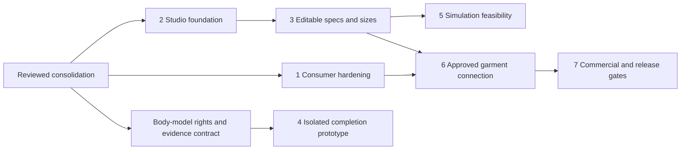

# On You — executable development roadmap

**Planning baseline:** the consolidated review candidate, not old main or a wholesale unmerged branch. Read [the consolidation report](ONYOU_FOUNDATION_CONSOLIDATION.md) before starting a task and [the architecture](ONYOU_PLATFORM_ARCHITECTURE.md) for contract semantics, licensing and accuracy boundaries. Future paths below are proposed work, not implemented modules. No new studio, learned completion, cloth engine, marketplace or account system is shipped by this roadmap.

## Sequencing, owners and parallel tracks

Numbering is the approved product milestone order, not a requirement to serialize independent implementation. After consolidation, Goals 2–3 and Goal 4 may proceed on separate branches. Standardized nonpersonal models unblock the studio without waiting for personal completion. Goal 5 can use those models and does **not** depend on Goal 4. Goal 6 may publish honestly illustrative assets without claiming Goal 5 physical simulation or Goal 4 personal accuracy. Privacy/licensing gates apply immediately, not only at Goal 7.

Suggested owners: native iOS engineer for Goal 1/consumer importer; web/product engineer for Goals 2–3; geometry/ML researcher plus licensing/privacy reviewer for Goal 4; simulation specialist/vendor-integration engineer for Goal 5; shared-contract owner coordinates version/units/provenance across all tracks. One integration owner reviews shared schema changes; UI and research owners do not independently invent competing avatar/garment formats. Keep each goal on a dedicated draft review branch; no automatic main merge.

Shared interfaces are the versioned records in the architecture document. Implement the minimum schema with an actual producer and consumer, maintain canonical cross-language fixtures, name incompatible changes explicitly and preserve current saved data. Do not build unused abstractions for all future capabilities up front.

## Goal 1 — Consumer Scanning Integration Hardening

**Objective:** close the source/runtime evidence gap in self-start, pause, recovery and cancellation after integration, without another scanner architecture. Physical reconstruction/accuracy remains a separate gate.

**Status:** the source-level implementation and bounded coordinator/app evidence on this review branch are recorded in [Consumer Scan Hardening](ONYOU_CONSUMER_SCAN_HARDENING.md). Do not repeat the completed countdown/native-start work. Goal 2 is the next major implementation; native human reconstruction and accuracy remain unverified.

**Reuse:** `BodyCaptureModel`, `BodyScanCameraStatus`, `BodyCaptureCamera`/controller, `BodyCaptureArchive`, `BodyCaptureCoverage`, `BodyCaptureTurn`, existing saved-avatar transaction and current scene/capture UI. PR #29 already implements the feature and native-pose filtering; do not implement it again.

**Exact missing work:** the original deterministic coordinator gap is addressed in the hardening handoff: actual countdown/wait, native-start completion, pause/generation fences, recovery and failure/unwind behavior now have focused coverage. Physical/native input and reconstruction validation remains outstanding, not a dependency of a standardized-model studio. Keep every capability/framing/quality gate intact; controlled test outcomes are not camera evidence.

**Dependencies:** reviewed consolidation and affected-case execution authorization for this next task; no phone, LiDAR data, new model, backend or studio. Native depth/intrinsics/rotating-human assumptions stay documented, not guessed around.

**Files/modules:** `Sources/OnYou/BodyCaptureModel.swift`, `BodyScanCameraStatus.swift`, narrowly scoped controller interface if necessary, existing `Tests/BodyScanUXTests.swift` or a cohesive coordinator case file, and the current scan refinement/consolidation handoff. Do not touch garment geometry, legacy calibration, stores or the native pose algorithm unless a new concrete defect is demonstrated.

**Deliverables:** deterministic existing-model lifecycle coverage; focused repairs for observed failures only; documented native input/capability limitations and exact new verification receipts. No unused framework, synthetic complete-scan route or global testing mode.

**Definition of done:**

1. Arming before framing admits no samples; countdown occurs once, then waiting accepts only fresh valid calibration.
2. Long framing waits do not repeat countdowns or create multiple native starts.
3. Cancel/help/inactive/dismiss invalidate pending intent; a late result from an older generation cannot change the next capture.
4. A native start already in flight is reconciled with its true result, including a prompt pause, rather than leaving native capture running behind framing UI.
5. Missing-view recovery retains admitted sample IDs/direction and targets only gaps; it does not demand two full turns or clear usable photos.
6. Interrupted processing/retry and cancel cleanup preserve the last saved avatar and honor native-work unwinding. Assert newly affected transitions, not copies of existing persistence tests.
7. No thresholds, segmentation/depth requirements, saved-model integrity or scan provenance are weakened. No exact user-visible wording tests are added.
8. A bounded affected-case run and one actual app smoke are recorded against the new source identity; historical PR #29 counts are not relabelled. Unsupported simulation/hardware paths remain explicit.

**Risks/deferred verification:** real countdown usability/audio routing, phone/subject motion, native sample import, articulated-human reconstruction, actual body visibility, physical scale and fit remain hardware/data-dependent. A clock seam proves ordering only. Do not silently retain failed/raw personal captures to help the future completion prototype.

**Must not rebuild:** Aashu's ARKit session, Vision/depth analyzer, coverage/spatial guide, native reconstruction, saved-avatar validation, closet or try-on renderer. Do not add mandatory measurement entry, voice commands, uploads or a partial-avatar completion fallback.

## Goal 2 — On You Studio Foundation

**Objective:** implement a small, usable desktop-browser T-shirt project workspace, independent of personal scanning or completion.

**Reuse:** licensed authored reference geometry and its notices, `GarmentScanDimensions`/finished-garment measurement concepts, explicit `GarmentSizeChart` basis distinctions, immutable geometry and integrity concepts. Reuse semantics/assets through adapters; Swift/SceneKit source is not a browser runtime and 25 image landmarks are not a sewing pattern.

**Exact missing work:** future `Studio/` app; project creation/open/save; a maintained T-shirt template/illustrative garment representation; nonpersonal standardized model selection; actual 2D/3D workspace and explicit project export/reopen. Create only `GarmentProject`, `GarmentRevision`, `MeshAssetDescriptor` and `FitModelRevision` contracts needed by that workflow, with schema fixtures. No backend or authentication.

**Dependencies:** consolidation, architecture decision and confirmed asset rights; no Goal 4 or validated human reconstruction. Proposed TypeScript/React/Vite/SVG/Three.js choice is justified in the architecture; confirm browser/file constraints before adding packages, do not choose another stack without a replacement decision record.

**Files/modules:** new `Studio/`, minimum `Shared/Contracts/`, local project repository, UI/editor/viewer adapters and asset provenance/build tooling. Existing consumer sources stay unchanged except an intentionally consumed future contract adapter.

**Deliverables:** functioning local project lifecycle, visible T-shirt/model workspace, two labelled authored nonpersonal fitting-model variants, schema/asset identity checks, downloadable self-contained project package and a short operator guide. Models are not demographic percentiles or personal scans.

**Definition of done:** create/name a T-shirt project, choose a supported template and model, save/reload/export/reimport the exact project and revisions; unsupported/quota/write errors do not erase the last acknowledged save. UI renders actual selected geometry and distinguishes illustrative preview. Model switching genuinely changes geometry; controls work with keyboard/large text. Inspect actual browser surface and exercise local persistence. No fake server acknowledgements or inert toolbar placeholders.

**Risks/deferred verification:** browser durability/eviction, WebGL and file support, unit/frame conversion, asset license and designer workflow usefulness. No pressure/fit/manufacturing claim; physical samples remain necessary.

**Must not rebuild:** shopper iOS UI, scanner, native renderer, closet, body-completion system or physics engine. No payments, marketplace, business accounts or mandatory cloud storage.

## Goal 3 — Editable Garment Specifications and Sizing

**Objective:** make meaningful T-shirt edits, named sizes and revision comparisons useful to an independent designer before physical sampling.

**Reuse:** Goal 2 project/viewer/repository; current meter-based garment endpoint concepts and legacy finished-garment/body-recommendation distinction. Keep existing native shirt capture unchanged.

**Exact missing work:** supported front/back/sleeve/neckband pattern representation with stable piece/edge IDs and seam map; editable POM/parameter constraints; base size and explicit size-specific grade increments/values; immutable revision history, comparison and useful specification export. Define supported template/import subset; imported CAD is not automatically lossless or cut-ready. No universal image-to-pattern reconstruction.

**Dependencies:** Goal 2 and designer-approved endpoint/template definitions. No Goal 4, personal avatar or physics dependency. Goal 5 consumes these patterns later.

**Files/modules:** `Studio/` pattern/spec editor, sizing and revision domain/repository, SVG/illustrative mesh adapter and exports; `Shared/Contracts/` pattern/spec/size/grade/material-identity records and fixtures. Do not port a private Swift view's incidental field names into the shared schema.

**Deliverables:** edits that change actual 2D/illustrative 3D geometry, multiple named sizes, size/revision comparison, save/restore and a revision-bound project/spec package. Export POM CSV/JSON and a documented vector/pattern subset actually implemented; PDF/DXF/tech-pack claims require real format support and loss disclosure.

**Definition of done:** changing length, finished flat body width, shoulder or sleeve parameters changes the intended geometry and reported endpoints without silently changing unrelated POMs. Explicit grade rules produce size-specific pieces/specs, not uniform mesh scaling. Save/reopen preserves units, topology, seams and revision lineage; restore makes a new revision rather than rewriting history. Invalid/unsupported edits/imports are reported without corrupting prior revisions. Export names revision, size, units, tolerance, source and unvalidated/cut-readiness status. Real round-trip/UI checks cover boundaries and transitions, not default text or mock echoes.

**Risks/deferred verification:** manufacturing endpoint ambiguity, seam ease/notch registration, material unknowns, export interoperability and physical grade/fit validation. A designer's size labels are not population-fit guarantees; shader parameters are not fabric mechanics.

**Must not rebuild:** local studio project foundation, consumer scanning, measurement onboarding, cloth physics, marketplace or generic CAD software. Do not require shoppers to enter brand specifications.

## Goal 4 — Statistical Avatar Completion Prototype

**Objective:** determine whether a properly licensed parametric model can fit incomplete observations with explicit support/uncertainty and abstention. This is a new capability, not an already completed branch.

**Reuse:** observation/pose/depth association concepts, immutable mesh/hash/coordinate checks and licensed authored reference baseline. The current `BodyShapeKernel` is a procedural measurement-driven baseline only; it is not a learned estimator. Current raw capture cleanup and saved avatars stay untouched.

**Exact missing work:** pinned commercial evaluation rights, isolated observation importer/normalizer, licensed shape/pose fitting, visibility/support maps, residual/sensitivity report and held-out evaluation. Obtain a purpose-authorized calibrated dataset; do not assume current saved USDZ or yaw bins supply missing camera/region evidence. No model download until code/model/weights/data/output/deployment rights are clear.

**Dependencies:** commercial/data/privacy gate and the minimum shared avatar/evidence contracts. Goals 2–3 may run in parallel using standardized models. Company R&D is not automatically allowed by academic noncommercial licenses. If rights are unavailable, record the statistical comparison blocked; procedural baseline plumbing is not a completed statistical feature.

**Files/modules:** future `Tools/AvatarCompletionPrototype/`, `Shared/Contracts/` avatar/observation/support/uncertainty records; a separate fixture/evidence workspace outside personal stores. No production native store or scan acceptance change.

**Deliverables:** reproducible small licensed experiment fitting masked partial depth/mesh plus silhouettes/joints, separate output mesh/lineage/support map, neutral/no-completion baseline, held-out-view/region ablations and a go/no-go report. Use one model family initially; no giant dataset, training program, broad model bake-off or consumer upload service.

**Definition of done:** partial evidence is correctly registered in declared units/pose; omitted observations contribute no measurement loss; observed versus weakly constrained/prior-only/unknown regions remain recoverable. Results name model/license/code/input/transform versions and failure/abstention. Compare against baselines without tuning on holdout subjects/views. Synthetic numerical error is labelled synthetic; independent human-reference accuracy, bias and repeatability remain future validation. Output cannot masquerade as a captured `AvatarScanAsset` or qualify personal sizing.

**Risks/deferred verification:** non-identifiability under clothing/occlusion, prior bias, scale/pose ambiguity, overly confident covariance, commercial rights, device memory/thermal/time and identifying body geometry. Workstation success is not an on-device performance result; server use requires a separate explicit consent/security design.

**Must not rebuild:** scanner, saved-avatar store or renderer; no silent retention/training on customer captures, unlicensed dataset ingestion, mandatory missing measurements or automatic inferred-body sizing admission.

## Goal 5 — Garment Simulation Feasibility

**Objective:** select an honestly scoped path beyond illustrative draping, or document why commercial rights/deployment/numerical requirements block it. Do not build a full physics engine.

**Reuse:** Goal 3 pattern/seam/size revisions, Goal 2 licensed standardized models, native visual shell only as an illustrative baseline and shared immutable run/version metadata. Personal completion is not a dependency.

**Exact missing work:** written commercial apparel API/engine evaluation access; exact fabric/seam/contact inputs; one reproducible candidate run or a clearly documented unavailable prerequisite. Evaluate CLO/Browzwear hosted/plugin/CLI options against a bounded IPC/contact-component proof, not an assumption that a collision toolkit is a complete apparel solver. PhysX may be a real-time visualization comparator only where its GPU/platform terms fit.

**Dependencies:** Goal 3's supported pattern/seam contract and model/material rights. Commercial API access is a real prerequisite, not a mockable success. Stop the component path if it becomes a full constitutive-model/time-integrator/garment engine project.

**Files/modules:** future `Tools/GarmentSimulationFeasibility/`, a small solver/vendor adapter, shared `MaterialRevision`/`SimulationRun`/result-status schemas and evidence outside product stores. No iOS physics migration.

**Deliverables:** one T-shirt/model/material/pose input set with units and full versions; candidate rights/deployment/operation comparison; a real run when permitted, termination/failure reporting, numerical repeatability/perturbation observations and a buy/integrate/defer decision. If no runnable licensed candidate is available, say exactly what is blocked rather than fabricating drape output.

**Definition of done:** supported pattern/seam correspondences round-trip; run names exact mesh/material/model/solver/settings; failures and unsupported inputs surface; changes are traceable and repeatability has a declared numerical tolerance. Distinguish illustrative, simulated and physically validated results in data/UI. A successful solver/nonintersection result does not produce a pressure/fit score or remove physical samples. Any physical sample/fabric/pressure validation is explicitly pending, not required to complete the feasibility decision.

**Risks/deferred verification:** material calibration, shell/contact resolution, solver stability, browser/native/GPU deployment, vendor/headless rights and actual garment/fit accuracy. Public API documentation is not permission to redistribute a commercial engine.

**Must not rebuild:** CAD suite, cloth solver from scratch, native try-on engine, personal avatar completion, accounts, retailer integrations or commerce.

## Goal 6 — Connect Brands and Consumers

**Objective:** move an approved, revisioned garment into an honest compatible consumer preview without marketplace scope or forged capture provenance.

**Reuse:** Goal 2–3 project/revisions/specs; current consumer scene/pose/integrity/closet concepts; Goal 1 hardened capture/storage boundaries. Simulation/completion may remain absent, and their absence must be labelled.

**Exact missing work:** versioned approved `PublishedGarmentPackage`, source/size/rights/status compatibility validator, a real package export/import path, separate brand-garment consumer identity and viewer adapter. Do not force brand assets through `GarmentPatternEvidence` or synthesize a metric camera record. Validate meter/frame/pose/material/asset-hash compatibility and expose unsupported states.

**Dependencies:** Goal 3 and approved shared contract; Goal 1 for personal-store safety. Goal 5 is required only for simulation claims, not illustrative publication. No dependency on personally completed hidden anatomy.

**Files/modules:** `Studio/` approval/export, `Shared/Contracts/` published garment schemas/fixtures, a narrowly scoped `Sources/Closet/` brand-origin import model and `Sources/TryOn/` rendering adapter. Transport/backend is a separate decision; a local approved package proves compatibility first.

**Deliverables:** one actual approved T-shirt revision/size package exported by studio and imported/viewed by the native consumer; immutable product/revision IDs, rights/hash validation, compatibility/status UI and safe replacement/rollback. Keep private source patterns/manufacturing IP out of public packages unless explicitly approved.

**Definition of done:** selected revision and size are the assets actually rendered; switching or invalid/canceled import cannot overwrite the saved body or an unrelated garment. Invalid hashes/schema/pose/units/rights fail with recovery. Consumer labels illustrative or unvalidated simulation honestly; no exact sizing recommendation, fake capture success or body upload. Reopening retains provenance and revision association.

**Risks/deferred verification:** rights/IP leakage, unsupported asset features/scale, stale version/cache identity, trust/signing strategy and future distribution security. Personal fit remains unvalidated even when the transport and rendering round-trip pass.

**Must not rebuild:** shopper closet/scanner/renderer, studio editing, catalog marketplace, payments, retailer scraping or social sharing.

## Goal 7 — Commercial and Release Readiness

**Objective:** address release, collaboration/accounts and commercial operations only when justified by actual designer/shopper workflow demand and supported evidence.

**Reuse:** adapted release/device/fit validation docs, existing local privacy/storage, shared package provenance and all prior implementation. Historical receipts remain pinned to their original commit; they do not validate a release candidate.

**Exact missing work:** owner-approved distribution/support/legal/privacy plan; scoped hardware/accuracy/material studies when authorized; current release/resource/privacy/signing matrix; business account/collaboration/backend/billing requirements only if real users need them. Do not postpone baseline privacy/licensing until this goal.

**Dependencies:** concrete product usage/requirements, rights/security reviews and owner distribution authorization. Physical study participation/hardware is a future gate, not required of the current user to finish consolidation or local studio work.

**Files/modules:** release checklists/privacy disclosures, entitlement/distribution configuration, approved account/collaboration/billing modules only after selection, deletion/retention/security contracts and operational runbooks. No credential changes without permission.

**Deliverables:** candidate-specific release evidence and explicit outstanding gates; account/role/revision ownership and deletion design if needed; scoped commercial release decision. Add billing only with clear pricing/demand/transaction requirements and separate authorization.

**Definition of done:** all claims match actual candidate evidence; retention/deletion/backup/permissions/resource isolation and third-party rights reviewed; authorized distribution checks completed or explicitly blocked. Real accuracy/simulation claims require independent physical proof. No automatic main merge, store submission or production-ready label from simulator/compile evidence alone.

**Risks/deferred verification:** biometric-like data, vendor terms, dataset representation, account/IP security, costs, regulatory/consumer claims and actual garment outcomes. A negative release decision with precise unmet gates is valid; fabricated passes are not.

**Must not rebuild:** working consumer/studio workflows, scanner/geometry systems or a marketplace merely to introduce billing.

## Technical proof policy for every goal

- Record base/head/source identity and exact inspected paths. Classify done/missing/uncertain before edits; do not reimplement merged work.
- Preserve current tests and behavior assertions. Update tests for actual contracts, not incidental wording or implementation defaults; do not delete/skip failures just for green output.
- No broad automated campaign or hardware request without separate authorization. A scoped task may authorize its affected deterministic/runtime smoke explicitly; distinguish that from historical tests and full-release proof.
- UI work needs actual rendered/interactive surface evidence; mocks or source inspection alone are not UI proof. Synthetic/mannequin assets are labelled and never represent a personal scan.
- Code/math tests establish code/math only. Real human geometry, metric accuracy, fabric response, pressure, fit and commercial rights each need their own evidence. No performance claim without measurements.

## Historical Goal 1 task scope — do not repeat

The following prompt records the assignment implemented by the hardening branch. Use its handoff for exact verification boundaries; begin the next major development assignment from Goal 2 above, not by re-running this historical scope.

> Continue `anshbalusa-ui/itchathon` from the reviewed foundation consolidation PR/head. Refresh main and the integration head, preserve all existing work and use a new dedicated branch/worktree. Read the consolidation/architecture/roadmap and current `BodyCaptureModel`/`BodyScanCameraStatus` before editing.
>
> Harden only the existing self-start/recovery/cancellation coordinator. It already implements five-second arming, fresh-framing wait, speech, missing-angle retention and native-pose consistency: do not rebuild them. Add the smallest deterministic clock/native-start boundary needed to exercise the real coordinator's task ordering, without weakening runtime camera capability/framing checks or introducing a fake scan-success mode.
>
> Cover one countdown then a long wait; fresh versus stale calibration; cancel/help/inactive/dismiss during countdown/wait; native start completing while a prompt pauses; old-generation callback after cancel/retake; and missing-view recovery preserving admitted IDs/direction. Reuse existing persistence/coverage tests rather than duplicate them. Repair only concrete failures. Preserve the last successful avatar, current raw-work cleanup and every photo/pose/depth/segmentation/coverage threshold.
>
> Scope production edits to `BodyCaptureModel`, `BodyScanCameraStatus` and a minimal existing-controller seam only if needed. Do not touch garment draping, studio code, statistical completion, storage formats, mandatory measurements, voice commands, uploads or native reconstructed poses. Do not invent camera intrinsics or claim human reconstruction from synthetic input.
>
> For this next task, authorize only the affected deterministic cases and one relevant actual-app smoke; no broad regression/release/benchmark campaign or physical iPhone/body-scan request. Record exact new source/results, unsupported capability limits and unexecuted hardware/accuracy checks. Update the existing handoff, commit/push the scoped changes and open a draft PR; do not merge main or modify teammate PRs automatically.
