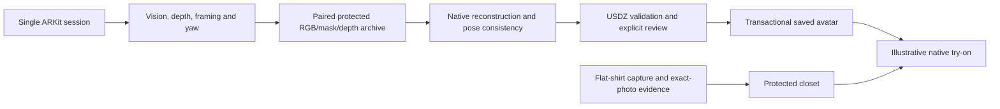

# On You — platform architecture

**Decision record, 2026-11-22.** This is the next-product specification, not a claim that a studio, statistical model or cloth solver exists. The native iOS application remains operational and its current scan/storage/illustrative-try-on architecture is retained. See [consolidation](ONYOU_FOUNDATION_CONSOLIDATION.md) for implementation/evidence and [execution](ONYOU_EXECUTION_ROADMAP.md) for owned tasks and acceptance gates.

## 1. Product and implementation boundaries

| Experience | Retain/reuse now | Future addition | Do not claim |
| --- | --- | --- | --- |
| Shoppers — native iPhone | `OnYouRootView`, `BodyCaptureModel`/camera/analyzer/archive, review, `AvatarScanStore`, `ClosetStore`, `TryOnBuilder`, SceneKit viewer | Optional, provenance-aware completion; approved published garments | A completed-looking mesh proves anatomy, exact dimensions, fit or hidden surfaces |
| Brands — desktop/web-first studio | Domain concepts and licensed reference assets; current garment dimensions and image association as explicit illustrative inputs | T-shirt project/pattern/spec editing, named sizes, standardized fit models, revisions and export | Current flat-shirt observations are manufacturing patterns or validated simulation |
| Shared fitting technology | Existing immutable mesh data, scale/integrity checks and pose/garment-admission concepts | Versioned data contracts and separate completion/simulation adapters | One new cross-platform runtime must replace the existing Swift app |

Shoppers position iPhone once, arm capture, step into view, turn in place and recover only missing usable views. No mandatory measurement form, helper, partial-body success or three-height routine. When full-body evidence is inadequate, current capture must reject/recover; this goal adds no inferred-success path. Designers may edit precise garment values because manufacturing needs them. Those controls never become consumer onboarding requirements.

## 2. Retained consumer iOS architecture

- `BodyCaptureCamera` owns the AR session/serial sampler. Preserve current format/depth association, thresholds and actual camera movement checks; do not silently switch lenses.
- `BodyCaptureCalibration`, `BodyCaptureEvidence`, `BodyCaptureFrameAnalyzer`, `BodyCaptureTurn` and `BodyCaptureCoverage` own admission. Yaw tracking, head/ankle evidence and silhouette bounds are not proof of every body region or a successful native human reconstruction.
- `BodyCaptureModel` owns countdown, phase/generation, native work and recovery. Native poses are native outputs, not stationary AR camera transforms or fabricated orbit positions. Keep admitted IDs consistent through recovery and final validation.
- `ScannedAvatarGeometry` loads USDZ with Y-up/meters conversion, validates textures/bounds/scale and centers/grounds the scene. It does not independently establish anatomical front or metric accuracy.
- `AvatarScanStore` retains its active record, content hash, protected directories and transactional replacement. Cancel/failure must not replace the last successful saved avatar.
- `GarmentPatternEvidence` is 25 normalized image landmarks tied to the exact upright PNG hash. `GarmentScanDimensions` means body flat width, length and sleeve span in meters. Neither is a sewn pattern, a chest circumference, mechanical fabric data or an accuracy certificate.
- `TryOnBuilder` verifies actual saved-avatar and shirt bytes even on cache hits; `TryOnModel` fences stale/canceled results. Keep its bounded avatar/pattern/scene caches and supported-pose rejection. The rear texture and shell behavior remain illustrative.
- Optional `BodyMeasurements`/`BodyShapeKernel` rendering and old FitCheck labs stay separate from captured personal geometry. Their output cannot mint an `AvatarScanAsset` or authorize captured-avatar try-on.

No module/scheme rename: customer name **On You**, internal module **FitCheck**, current iOS deployment target/settings remain in `Project.json`. Do not move all existing files into new packages as part of contract adoption.

## 3. Studio architecture decision

### Proposed first implementation

Use a **local-first desktop-browser workspace**, with TypeScript, React and Vite for the future studio UI, SVG for the initial 2D pattern view and a small Three.js adapter for an illustrative 3D view. This is a documented proposal for Goal 2; no frontend dependencies or web application are added by consolidation.

Why this shape:

- Independent designers can use Windows or macOS without replacing the native shopper app or installing a new mobile framework. Large-screen point-of-measure editing and revision comparison fit a desktop workspace.
- Vite's client application avoids adding SSR, authentication or a server for a private single-user authoring tool. React supplies a conventional component/accessibility ecosystem; domain records remain plain data outside components. Three.js handles browser mesh/glTF viewing without pretending SceneKit code runs in a browser.
- Start with IndexedDB for project records/assets and explicit project-package import/export. Request durable storage where supported, surface quota/write failures and explain that browser storage is not a backup. Private browsing/eviction must not silently lose an acknowledged save. A downloadable self-contained project is the recovery boundary.
- No backend, account, upload, analytics, collaboration, marketplace or payment is required for Goals 2–3. Do not promise iOS-style file protection for browser storage; explain local-machine/browser access and protect brand IP. Remote persistence requires a later threat model and explicit product decision.

Alternatives evaluated: native SwiftUI macOS reuses Swift but excludes Windows designers; Electron/Tauri adds packaging/security/update work before native integration is needed; a hosted SSR/backend stack adds operations and identity without an initial requirement. Revisit a native companion only if licensed CLO/Browzwear integration, durable filesystem requirements or measured browser limits justify it. Their native plugins cannot simply be loaded into a browser.

### Future boundaries, not directories created in this goal

| Proposed module | Ownership and inputs/outputs |
| --- | --- |
| `Studio/` | Brand UI, local project repository, SVG editor, comparison, 3D adapter and exports; no consumer body collection |
| `Shared/Contracts/` | Versioned JSON Schemas, canonical examples and cross-language fixtures for the records below; no UI or Apple SDK types |
| `Sources/OnYou/` adapters | Read existing Swift records without rewriting old stores; convert only when a real consumer needs the new contract |
| `Tools/AvatarCompletionPrototype/` | Isolated licensed observation-fitting experiment; never installed in the shopper admission path |
| `Tools/GarmentSimulationFeasibility/` | Bounded vendor/component evaluation and reproducible run adapters, not a new production physics engine |

Share formats, semantics, licensed assets and mathematical fixtures first. Do not introduce unused production DTOs, compatibility aliases or a multiplatform rewrite merely to establish folders. Implement a contract with its first producer and consumer.

## 4. Shared contract specification

All future envelopes have `schemaVersion`, stable UUID identity, immutable revision identity, UTC creation time, producer/version, asset SHA-256 references and a validation state. Unknown schema versions or incompatible assets must be reported, not silently interpreted as current. Optional unknown evidence is represented as unknown, not zero or confidence 1.

### Geometry convention and conversion

Canonical interchange is right-handed, Y-up, meters; frontal rendering looks toward the origin from +Z. Declare X numerically in this frame; anatomical left/right are explicit semantic labels, never inferred from a screen coordinate. Positive rotations follow the right-hand rule. Matrices are column-major, transform column vectors and declare source/destination frame IDs. Positions, normals, winding and transforms must round-trip through a known asymmetric fixture.

Keep the original native USDZ and its source frame. A `sourceToCanonical` matrix is usable only with declared basis/scale/front evidence; a missing or estimated anatomical front must stay `unknown`/`estimated`, not identity-by-assertion. Current try-on's supported-standing pose/yaw estimate is not a validated skeletal registration. USDZ serves iOS; a derived GLB may serve the studio, linked to source hash, conversion version, transform and license. Shader roughness is unrelated to cloth stiffness. No centimeter/meter or flat-width/circumference inference is allowed at adapter boundaries.

### Records and invariants

| Record | Required contract fields and rules | Existing mapping / missing work |
| --- | --- | --- |
| `MeshAssetDescriptor` | Asset ID/hash, format, vertex/index/topology versions, units/basis, bounds, normals/winding, pose/frame IDs, license/provenance. Topology-dependent maps name the topology hash. | `RendererMesh`, prepared USDZ and current bounds/hash checks exist; cross-platform envelope/conversion is future work. |
| `AvatarDescriptor` | Avatar/revision/source IDs; geometry kind (`nativeScanSurface`, `manualIllustration`, `standardFitModel`, `statisticalCompletion`); mesh references; scale kind (`nativeDepthEstimate`, `legacyReferenceHeight`, `priorEstimate`, `unknown`); front/pose status; evidence map and allowed uses. | Adapt `AvatarScanRecord`/`AvatarScanAsset` without changing old hashes or manufacturing evidence. Current records lack region-level support. |
| `ObservationSet` | Ephemeral frame/sample IDs, image/depth resolution and orientation, timestamp association, calibrated intrinsics and transforms with validity, foreground/depth confidence/masks, joints, occlusion and source hashes/consent. | `BodyCaptureStoredSample` has RGB/depth/mask URLs, yaw, full-body flag and gravity; not a durable calibrated completion input. Raw images are currently deleted after successful review preparation. Do not secretly retain them. |
| `RegionEvidence` | Topology/region IDs; support kind (`directDepthSupported`, `registeredPhotoSupported`, `priorInferred`, `unknown`); source IDs; visibility/exclusion method; residual units; uncertainty method/version and calibration status. | Angle bins are not per-face observation evidence. Legacy reconstructed meshes default to unknown regional support, not wholly observed. |
| `GarmentProject` / `GarmentRevision` | Project ID, category `tshirt`, immutable parent revision, source/template license, design metadata, parameter values, size/material/pattern/preview references and validation status. | Current `ClosetGarment` is a shopper record; do not turn it into a brand project or reuse its UUID as revision history. |
| `PatternDefinition` | Stable 2D piece/curve/edge IDs in meters; closed boundaries, grainlines, notches, fold/cut sides, seam allowances, directed seam-edge correspondence, topology revision and supported import subset/loss report. | Image outline/25 landmarks are observations, not cut/seam geometry. Pattern generation/import is new work. |
| `GarmentSpecification` | Named points of measure with endpoint definitions, unit, tolerance, source and optional value. Distinguish finished flat half-chest, circumference, shoulder span, length and sleeve span. | Reuse `GarmentScanDimensions` concepts where semantically exact; `SizeChart` already distinguishes finished garments from body recommendations. No automatic conversion of unknown fields. |
| `SizeSet` / `GradeRule` | Base revision/size; named size labels; explicit per-POM/piece deltas or author values; constraints; size-specific outputs and comparison. | Legacy `GarmentSizeChart`/`GarmentSizeVariant` store size values, not a grading engine. Uniformly scaling a mesh is not grading. |
| `MaterialRevision` | Visual fields separate from mechanics. Mechanical data: thickness m, areal density kg/m², warp/weft/bias response, tensile/shear/bending units, damping/friction assumptions, source/calibration and uncertainty. Missing properties stay unknown. | Current SceneKit materials and shirt image contain no calibrated textile mechanics. |
| `FitModelRevision` | Standard nonpersonal model ID/hash, exact asset license, declared measurements/units, pose revision, frame/scale, collision surface and authored/observed provenance. | Existing CC0 reference is reusable as an authored display baseline, not a representative percentile or accurate personal model. |
| `SimulationRun` | Immutable garment/size/material/model revisions, solver/build/backend/version, mesh resolution, timestep/integrator, tolerances, gravity/contact/friction, seed when relevant, termination/failure, outputs/hashes and warnings. | No current solver. A successful process exit/nonintersection does not authorize fit/pressure claims. |
| `PublishedGarmentPackage` | Product/revision/size IDs; approval and rights; compatibility schema, frame/units/pose range; illustrative/simulated/validated status; asset hashes, spec/material references and limitations. | Future separate importer/adapter. Never fake a camera scan, 25-point capture evidence or metric garment record to fit today's `TryOnBuilder` API. |

Use separate allowed-use flags/status for **viewable**, **illustrative preview eligible** and **physically validated sizing**. Current software does not establish the last status. Neither a smooth mesh nor prior certainty can promote it. Brand approval is revision-specific, not an accuracy certificate.

## 5. Persistence and compatibility

1. Keep `OnYouScans/<UUID>/avatar.usdz`, its atomic `active.json`, `OnYouCloset/closet.json`, image association and existing manual-measurement namespace unchanged during consolidation. Preserve SHA verification on cache hits and last-successful-avatar replacement semantics.
2. Introduce future descriptors as versioned sidecars/new collections linked to immutable source IDs/hashes. Do not reinterpret `usesDepthScale`, synthesize old capture counts, replace source geometry with inference or relabel an example as scanned.
3. Inferred output is a **new artifact**, never an overwritten native USDZ or a fabricated `AvatarScanAsset`. Keep the observed source and fitting lineage separate; only explicitly selected display consumers may load the hypothesis. Current saved-scan sizing/try-on admission stays unchanged until a separately validated adapter is approved.
4. Sidecar publication must be transactional with its referenced assets. Unsupported/missing metadata can leave a legacy avatar viewable but must disable any new evidence-dependent use. Corruption must not delete the original saved model or unrelated closet data.
5. Studio saves immutable revision records plus hashes for referenced assets in IndexedDB, then explicitly exports a self-contained project package. Import validates schema, asset identity, units, supported pattern subset and rights; no silent lossy repair. Export identifies exact revision/size/units and warns when not cut-ready.
6. Preserve local protected, backup-excluded native capture work and current cleanup. Any future evidence export/retention is a separate, affirmative, purpose-bound action with deletion/retention behavior; abandoned captures are not a training dataset.

## 6. Statistical completion: research decision and future prototype

### Model and license evaluation

| Candidate | Technical relevance | Commercial/deployment gate |
| --- | --- | --- |
| SMPL | Compact articulated body/shape prior, useful baseline for partial 3D plus silhouettes/keypoints. | [Official terms](https://smpl.is.tue.mpg.de/modellicense.html) restrict use to noncommercial purposes and offer separate commercial licensing. Company R&D is not automatically exempt. Written rights must cover model/code/weights, outputs, deployment and redistribution. |
| SMPL-X / SMPLify-X | Adds hands/face and pose/fitting priors; useful comparator, more complexity than initial torso/body question. | [Model terms](https://smpl-x.is.tue.mpg.de/modellicense.html) and [fitting paper](https://openaccess.thecvf.com/content/CVPR2019/html/Pavlakos_Expressive_Body_Capture_3D_Hands_Face_and_Body_From_a_CVPR_2019_paper.html); no model or data import until commercial rights are cleared. Do not add face-photo collection. |
| STAR | Body-only sparse pose corrections; potentially useful alternative prior. | [Official license](https://star.is.tue.mpg.de/license.html) is noncommercial absent separate permission; not an unblocked commercial fallback. |
| GHUM/GHUML | Nonlinear articulated shape space worth a research comparison. | [Google Research release](https://github.com/google-research/google-research/tree/master/ghum) uses a gated model request. Repository availability is not a commercial grant for model/data/output use; unresolved rights block adoption. |
| CAESAR/HumanShape | Licensed anthropometric/shape sources may support evaluation or modeling. | [UMTRI provenance/licensing](https://humanshape.org/CAESAR) distinguishes packages and limitations. Purchase/access does not automatically include training, app redistribution or derived-model rights. |
| Existing authored CC0 template | Safe baseline for observation contracts and a procedural no-completion comparison. | Repo `DevelopmentAssets/HumanShowcase/LICENSE.txt`/`NOTICE.txt` pin the CC0 asset/conversion; MakeHuman software is separately AGPL and not imported. This is **not a learned statistical model** or a population-representative dataset. |

Pin and separately review fitting-code dependencies, topology/template, weights/priors, training/evaluation datasets, annotations, outputs and commercial app/server distribution. A license for one does not grant the others. Obtain written terms/legal review; no downloading/redistributing unlicensed models or datasets in this goal.

### Prototype boundary and fitting method

The future experiment asks whether partial observations constrain plausible complete geometry better than a neutral template, **not** whether a database can return exact hidden dimensions. Start in an isolated workstation tool. If a commercial model license is unavailable, only the authored procedural baseline/contract work can proceed; the statistical comparator remains blocked, not renamed as completed AI.

Input: purpose-authorized metric partial depth/mesh plus valid masks, joints/confidence, gravity, camera calibration and pose/frame transforms. Current `BodyCaptureStoredSample` is insufficient as a durable calibrated dataset; any future importer must establish calibration/association validity without inventing missing intrinsics. Goal 4 can use independently authorized calibrated fixtures without waiting for consumer-capture evidence retention. Keep clothed visible surface distinct from latent anatomy; do not shrink a body to match baggy clothing or infer hair/shoes as body measurements.

Fit global alignment/scale and pose nuisance variables with shape parameters. Use robust, visibility-masked point-to-plane/one-sided surface losses, silhouette distance, confidence-weighted joint reprojection and licensed shape/pose priors. Unobserved regions contribute **no observation loss**; missing pixels are not zero-depth targets. Compare pose-normalization versus joint fitting, and reject unsupported registration. Do not use symmetric whole-surface error that pulls hidden parts toward empty space.

Output: separate candidate mesh, support map, exact transforms, input/model/code/license hashes, residual summaries, parameter sensitivity, excluded regions and an abstention reason. Retain original observed geometry. Prior-only regions remain inferred even when optimizer covariance is small; covariance is model-conditional sensitivity, not calibrated anatomical accuracy.

Proof: compare no-completion/template/fitted baselines on held-out views and deliberately removed regions, with participant-level split when licensed consenting humans become available. Report failures/abstentions, repeatability, signed/absolute error, subgroup limits and independent reference uncertainty. Synthetic holdouts establish numerical behavior only. No customer sizing admission until independent physical validation and calibrated uncertainty/abstention gates exist.

On-device execution is the preferred eventual privacy boundary but memory/thermal/runtime and weight-distribution feasibility are unmeasured. Workstation experimentation is not a product upload path. A future server job requires separate affirmative consent, payload/purpose/destination/retention disclosure, encryption/access controls, deletion and privacy review, with no training or silent fallback upload. Do not choose a backend or promise latency now.

## 7. T-shirt studio and simulation boundaries

### Focused designer workflow

Goal 2 begins with private project creation, a maintained licensed T-shirt template/explicit illustrative representation and standardized nonpersonal fitting models. Goal 3 adds editable POMs/pattern parameters, explicit size rules, immutable revision comparison, durable project round-trip and useful specification export. Export includes revision, units, endpoints/tolerances, size chart, piece/seam information actually authored and known limitations. A DXF importer must name its supported subset and loss report; no generic photograph-to-manufacturing-pattern claim. Publish-ready packaging is Goal 6, not a marketplace.

A studio may initially show **illustrative preview** only. **Simulated** means a named reproducible solver/model run, not empirical accuracy. **Physically validated** requires independent fabric/sewn-sample/body/pose evidence under a defined protocol. Current try-on establishes none of the latter two and does not make samples obsolete.

### Technology feasibility decision

| Candidate | Source-supported capability | Decision / missing proof |
| --- | --- | --- |
| IPC Toolkit | [MIT license](https://ipctk.xyz/about/license.html); [documentation](https://ipctk.xyz/tutorials/simulation.html) explicitly says it is not a complete simulation framework. Contact/barrier/friction/collision components, not garment authoring. | Credible component for a **bounded** numerical feasibility spike only. Avoid committing to build a full cloth engine; seams, constitutive fabric, meshing/integration and deployment still need work. Audit pinned/transitive/optional licenses. |
| PhysX 5 | [Official guide](https://nvidia-omniverse.github.io/PhysX/physx/latest/index.html) describes real-time PBD/GPU cloth and separates CPU/GPU components and terms. | Interaction/visualization comparator only; verify exact platform/CUDA/package rights. Not a drop-in browser/iOS apparel solver or calibrated fabric model. |
| CLO | [Official API](https://developer.clo3d.com/) describes plugins hosted in CLO on Windows/macOS; [scenario/options](https://developer.clo3d.com/scenario.html) include simulation, materials and export. | Evaluate licensed apparel workflow/automation, not an assumed freely embeddable engine. Written API, seat, headless/service, redistribution and export rights required. |
| Browzwear | [VStitcher API](https://help.browzwear.com/en/articles/13066093-vstitcher-api), [licensing/authentication](https://help.browzwear.com/en/articles/13066095-license-and-authentication) and [engine CLI](https://help.browzwear.com/en/articles/13553151-how-to-start-working-with-vstitcher-engine-vs-cli) distinguish plugins/engine access. | Commercial evaluation candidate; public docs are not an embed/server license. Confirm supported automation, licensing and operating cost before selecting architecture. |

Recommended feasibility: one licensed T-shirt pattern and standardized model; explicit seam correspondences, gravity, mesh/material assumptions and one standing plus one arm pose. Compare a licensed apparel-host evaluation with a deliberately limited collision/cloth component experiment only if the latter is bounded and staffed. Stop if using IPC would become a full engine project. Save every solver/input/material/model version, termination/failure and output hash. Numerical repeatability, seam consistency and intersection handling are software proofs, not fabric/pressure validation.

Fabric thickness, warp/weft/bias stretch/recovery, shear/bending, damping/friction, body contact and grading cannot be recovered from the current shirt image or shader. Pressure/tension/color maps require explicit definitions and independent calibration; do not fabricate them. Sewing/physical sample comparison is a later unavailable validation program, not a prerequisite for this consolidation.

## 8. Privacy, rights and admission invariants

- No cloud uploads, accounts, new SDK/model downloads, personal scan logs, face-photo collection or training ingestion are introduced here. Native privacy declarations/local storage remain unchanged except the single already-reviewed DiskSpace reason.
- Geometry and inferred body parameters are sensitive even without a face texture. Retain minimum necessary data, separate consent by purpose, protect/delete derived artifacts with their source lineage and never silently reuse customer data for training.
- Standard models are nonpersonal, licensed and labelled. Do not call an authored mannequin a demographic percentile or a personal reconstruction. Document source-population gaps/bias before any statistical accuracy claim.
- A complete-looking hypothesis is not an observed complete body; an approved garment is not a physically certified fit. Capture completion, display eligibility, simulation convergence and sizing eligibility are distinct states with distinct proofs.
- Keep legacy records readable, old successful avatars intact, inference reversible and unsupported/missing evidence explicit. No default conversion of legacy geometry to inferred/observed certainty.

## 9. Open decisions and required proofs

1. Native rotating-human reconstruction quality, intrinsics/depth interpretation, front orientation and real metric scale are unresolved physical/platform assumptions, not repaired by this architecture.
2. Body-model commercial rights, corpus representation and output/deployment terms need written clearance before model use.
3. Browser durability, 2D-edit precision, asset conversion/frame parity and accessible large-screen controls need the small Goal 2 proof; no framework/backend is installed now.
4. Pattern subset, garment endpoints/tolerances and grade-rule semantics must be agreed with an independent T-shirt designer before calling an export manufacturing-ready.
5. Solver/vendor access, material calibration and physical validation remain separate gates. No selection implies exact fit, pressure, plausible hidden anatomy or sample elimination.
6. Business accounts/collaboration/distribution/billing are demand-driven Goal 7 work, not dependencies of local studio editing or isolated completion research. Privacy and licensing gates apply from the first prototype, not only at release.
