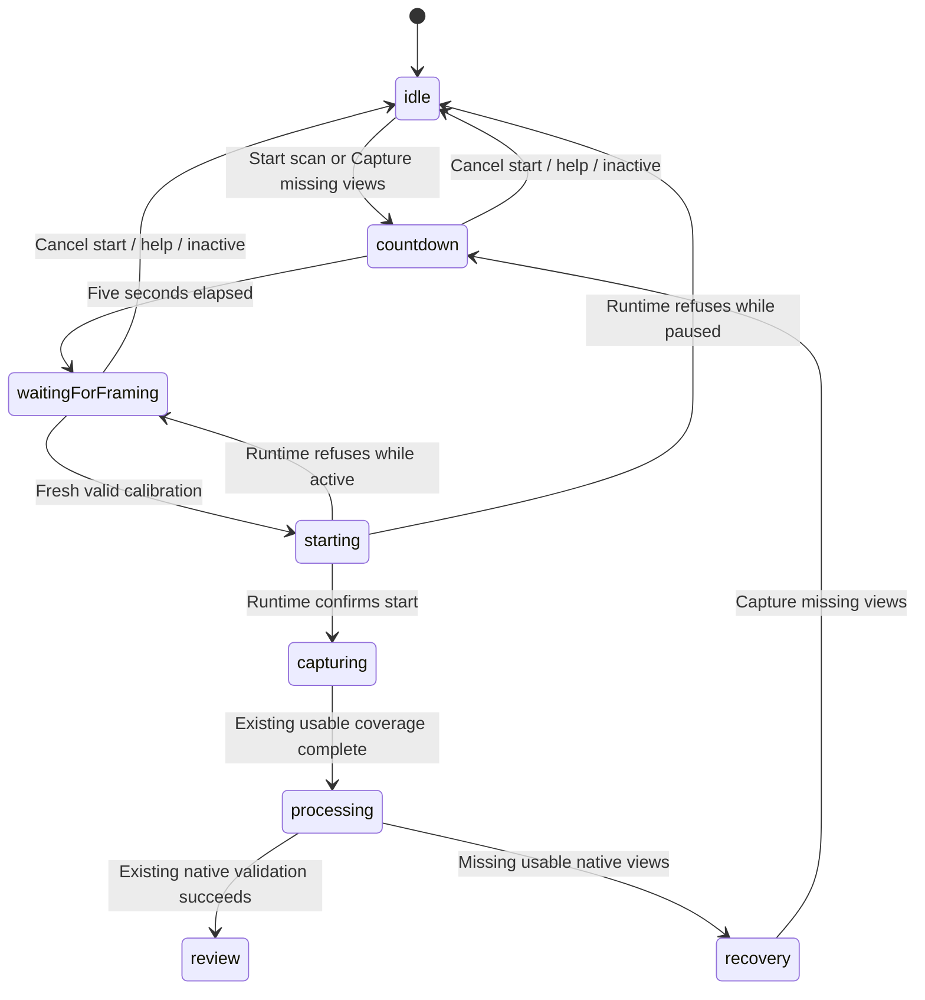

# On You — stationary full-body scan refinement

**Status:** targeted implementation on a review branch, not verified end-to-end human scanning or production readiness. No app launch, simulator/device journey, body scan, XCTest suite or benchmark was performed for this assignment. Compilation and an isolated host-side logic observation are distinguished below; neither validates native reconstruction, physical accuracy, spoken-audio usability or the actual capture layout.

## 1. Starting point and work protection

- Fetched `anshbalusa-ui/itchathon` again. Latest main at the start was **`b3e0397eb6ac1ce8ab13b84e00a645e1a49a6e8c`**, Aashutosh's **Rework camera-guided body and garment scans**.
- Created **`feature/onyou-stationary-scan-refinement`** from `origin/main` in a separate worktree. Main and the earlier uncommitted shorts/avatar work were not edited or merged into this task.
- Reviewed remote teammate branch heads and the open PR inventory. The only open PR was draft [#28](https://github.com/anshbalusa-ui/itchathon/pull/28), `review/onyou-release-readiness-20261110` (`16dccd39162dfcb3519d3cfc8f7211446b6d5b24`), based on `integration/onyou-final-gap-audit-20261109`.
- Compared #28's privacy delta with latest main. Ported only its existing DiskSpace `E174.1` manifest/verifier/assertion changes; did not import old scanner code, merge old feature branches, close teammate PRs or merge main.
- Classified findings were written before implementation. Findings below describe the starting source, not physically reproduced failures. The alignment issue also received the isolated mathematical observation in section 9.

## 2. Classified audit before changes

`DONE` means appears correct under source review, **not** that physical behavior passed validation.

| Component | Classification | Starting-source evidence and decision |
| --- | --- | --- |
| ARKit preview, RGB and LiDAR association | DONE | `BodyCaptureCamera` samples `ARSession.currentFrame`; `BodyCapturePhotoWriter.write` uses that same frame's image, scene depth, camera and gravity. Preserve the single-session architecture. |
| Pose, segmentation, full-body and arm evidence | DONE / UNVERIFIED physically | `BodyCaptureEvidence.fullyVisible` requires head evidence and both shoulders, hips and ankles with vertical ordering. `BodyCaptureFrameAnalyzer` checks pose confidence, 3D arm separation and confidence-filtered depth across the silhouette's upper/middle/lower regions. This is not a silhouette-bounds-only gate; it is also not proof of crown/toe or profile/back visibility. Preserve thresholds. |
| Stable automatic calibration and runtime start | DONE | `BodyCaptureCalibration` requires stable, fresh, front-facing/full-body evidence. Runtime `startScanning` locks that calibration and checks the current camera against its reference. Do not bypass it. |
| Mounted-phone self-start | INCOMPLETE | `BodyScanCameraStatus.canStart`, `BodyScanCameraView` and `BodyCaptureModel.performCameraAction` required calibration before the Start tap and started immediately. A solo user away from the phone could not arm first and step into view. |
| Ordinary spoken guidance and countdown | INCOMPLETE | Existing announcements used accessibility APIs only; no `AVSpeechSynthesizer` or countdown existed. Add local speech without recording or voice commands. |
| Helper-dependent framing/help language | NEEDS POLISH | Setup/help said to ask a helper and hand the phone back. Body runtime forwarded shared “Aim left/right/higher/lower” instructions intended for a camera holder. Use self-facing body guidance without changing shared shirt guidance. |
| Excessive-turn-rate feedback | NEEDS POLISH | `BodyCaptureTurn.continuousDelta` already rejected excessive rate, but the lost-pose fallback asked for arm separation. Distinguish the existing rate rejection; do not change admission thresholds. |
| Native reconstructed-pose coverage | NEEDS REPAIR | `BodyCaptureCoverage.alignedCoverage` gated median yaw residual, then counted every non-rejected pose toward completion. Inconsistent outliers could supply photo counts, full-body counts or angular sectors. Admit only coherent correspondences and carry their IDs through validation/recovery. |
| Missing-angle recovery, angular progress, spatial halo | DONE | Existing `BodyCaptureTurn`, retained coverage and `BodyCaptureSpatialGuide` already targeted missing views and retained confirmed sectors. Preserve; remove the redundant Start tap after choosing recovery. |
| Reconstruction output, review, save, closet/try-on | DONE at source boundary / UNVERIFIED physically | Native USDZ, textures/bounds/scale guards, transactional saved-avatar storage, integrity-bound try-on and cancellation fences exist. No direct storage/garment incompatibility justified rebuilding them. |
| Disk-space privacy declaration | NEEDS REPAIR | `BodyCaptureModel.start` still reads `systemFreeSize`, but main omitted the corresponding required reason already fixed in #28. Reuse that exact small fix. |
| Native rotating-human reconstruction, likeness and physical fit | UNVERIFIED | Object Capture supports rigid turntable objects; that does not establish articulated-human reconstruction, anatomical completeness, metric accuracy or garment fit. Preserve native quality gates and document uncertainty. |

## 3. Existing implementation preserved

The approved stationary-phone flow remains the existing implementation: ARKit capture and Vision analysis, person masks and matched scene depth, front-relative turn estimation, angle-based sample admission, angular coverage/spatial guidance, native `PhotogrammetrySession`, output validation, interactive review and explicit save.

Preserved specifically:

- `BodyCaptureCalibration`, `BodyCaptureFrameAnalyzer`, `BodyCaptureEvidence`: existing confidence, framing, pose, arm, depth and freshness checks.
- `BodyCaptureTurn`/`BodyCaptureCoverage`: original distinct-angle, minimum-photo, sector, maximum-gap, reacquisition and direction rules. Feedback and final native-pose evidence filtering are the focused deltas.
- `BodyCaptureArchive`: protected staged publication, clockwise portrait RGB/depth, upright masks, lazy reading and reader-failure propagation.
- `BodyCaptureSpatialGuide` and `BodyCaptureGuideState`: retained nodes, confirmed saved sectors, missing-angle marker, freshness expiry and Reduce Motion behavior.
- `BodyScanReviewView`, `PreparedAvatarScene`, `ScannedAvatarGeometry`, `AvatarScanStore`: actual textured USDZ review, detached preparation, validation and transactional storage. No template or synthetic scan-success substitution.
- `AutomaticGarmentScanView`, `GarmentCaptureCamera`, `ClosetGarmentDetailView`, `TryOnModel` and `TryOnBuilder`: shirt recognition/three-view consensus, explicit review/save, exact-image evidence, bounded caches and actual saved-avatar try-on. No draping, texture, retailer or storage-format rewrite.
- Legacy/manual measurements remain separate; no numerical input was introduced into capture.

## 4. Self-guided UX implemented

`BodyScanCameraStatus.StartState` separates user intent from permission to admit camera samples:



The countdown arms capture; it does not certify framing. Waiting is event-driven from camera updates, not a polling loop. There is no second countdown merely because framing took longer. A native start already in flight can finish immediately before a prompt pauses it: the model records the real result, so a running runtime is never left labeled as framing. The runtime stays paused while the prompt/inactive scene is present.

Additional UX changes:

- Positioning instructions explain secure upright placement, rear camera, clear head/feet/arm margins and even light. Start/Cancel stays outside scrolling guidance; the camera viewport is not resized by instructions.
- The five-second interval lets the person step into view; speech gives a short positioning cue and the final three counts. Existing stable framing must still pass before capture begins.
- `BodyScanVoiceGuidance` lazily owns one Apple synthesizer and at most one pending instruction. New instructions replace stale pending ones; view milestones, missing-view notices, processing and review are announced. Apple manages its separate speech audio session.
- **Spoken guidance** is independently switchable in Scan options. VoiceOver uses accessibility announcements instead of competing synthesized speech. Help/discard, inactive scenes and dismissal stop speech. There is no microphone permission, recording, external service or voice-command system.
- Body-specific centering/head-and-feet instructions do not guess left/right from an uncertain subject orientation. Distance cues still come from live depth/framing evidence; shared garment/haptic direction data is unchanged.
- Plausible steps rejected by the existing angular-rate limit now request a slower turn/held pose, while discontinuous/uncertain pose uses neutral reacquisition guidance. Accepted photos are retained.
- Missing-view recovery arms directly after the explicit recovery action. It retains admitted IDs and requests gaps rather than automatically resetting coverage or demanding another complete turn.
- Review announces that the avatar is ready to inspect, not that its anatomy, likeness or fit is validated. Explicit **Use this scan** still controls replacement of the saved avatar.

## 5. Reconstruction assumptions reviewed

| Question | Source/documentation conclusion |
| --- | --- |
| Subject yaw and native coordinates | Stored yaw is front-relative and computed from shoulder/hip axes in the AR world basis. Native poses are in Apple's estimated reconstruction basis. Existing sign/offset fitting relates angular labels without assuming identical origins or headings. |
| RGB, mask and depth orientation | RGB is physically rotated clockwise and saved with orientation 1. Vision segmentation is upright; the mask is resized to RGB dimensions. Native depth rotates clockwise with matching pixel-center/person-mask lookup. The portrait gravity vector is rotated consistently. Existing orientation regressions were inspected, not executed. |
| Intrinsics and depth association | Vision and world unprojection use the associated `ARFrame.camera.intrinsics`; the photo/depth writer receives that same frame. Custom JPEG samples do not preserve the AR calibration into `PhotogrammetrySample.camera`, which the SDK exposes read-only. Estimated intrinsics, depth interpretation and physical scale therefore remain an important native-validation uncertainty; no fabricated metadata was injected. |
| Stationary AR pose versus reconstructed viewpoint | Only native `.poses` output supplies `BodyCaptureReconstructedPose`. The physical AR camera transform is used for calibration, drift and unprojection, not substituted for native reconstruction poses. |
| Does the orbit check require a moving physical phone? | Not intrinsically. For a rigid turning object with transform `O_i` and fixed camera `C`, equivalent object-local camera transforms are `O_i^-1 * C`. Native virtual viewpoints can surround the subject even while the physical phone stays still. This mathematical equivalence does not prove a human remains rigid enough. |
| Can valid captures be falsely rejected? | Existing fitting permits either turn direction, a global angular offset and loss of the first frontal sample. Those safeguards remain. Native human pose estimation, centering, tolerance suitability, occlusion and deformation still require later physical validation. No gate was bypassed to manufacture success. |
| Can inconsistent samples falsely count? | The median-only defect is repaired. The original global fit gate remains; its coherent correspondences refit the basis offset, then only individual poses within the existing 25-degree tolerance count. Positions/rotations are not altered. The same admitted IDs drive final input counts and retained recovery evidence. |
| Missing/rejected/unreadable input | Unknown IDs and invalid poses fail closed; invalid/skipped inputs are excluded. The lazy reader remembers read errors, checked at setup and completion. Insufficient coherent coverage yields targeted recovery only where the remaining geometry supports it; otherwise alignment fails. |
| USDZ orientation and scale | Existing import converts Y-up/units to meters, requires texture and finite plausible bounds, and preserves legacy height calibration. For new depth-scaled scans, height is derived from reconstructed bounds, so scale one is not an independent accuracy measurement. Canonical front, complete anatomy and true metric error remain unverified. |
| Cancellation and retry source data | Existing generation fences/native cancellation protect publication. Retry retains its permitted source data; successful review preparation removes raw photos/checkpoints. Retake/cancel cleans private work without replacing the active saved avatar. Recovery now retains the coherent ID set instead of all native-pose keys. |

Apple references checked:

- [PhotogrammetrySample](https://developer.apple.com/documentation/realitykit/photogrammetrysample), [read-only camera metadata](https://developer.apple.com/documentation/realitykit/photogrammetrysample/camera-swift.struct).
- [Depth data and scale](https://developer.apple.com/documentation/realitykit/photogrammetrysample/depthdatamap), [object-mask dimensions](https://developer.apple.com/documentation/realitykit/photogrammetrysample/objectmask), [gravity](https://developer.apple.com/documentation/realitykit/photogrammetrysample/gravity).
- [Estimated sample poses](https://developer.apple.com/documentation/realitykit/photogrammetrysession/poses), [pose coordinate system](https://developer.apple.com/documentation/realitykit/photogrammetrysession/pose).
- [Rigid objects, turntables, overlap and deformation limitations](https://developer.apple.com/documentation/realitykit/capturing-photographs-for-realitykit-object-capture).
- [AR depth/frame relationship](https://developer.apple.com/documentation/arkit/ardepthdata), [configuration-compatible 4K format](https://developer.apple.com/documentation/arkit/arconfiguration/recommendedvideoformatfor4kresolution).
- [System-managed speech audio session](https://developer.apple.com/documentation/avfaudio/avspeechsynthesizer/usesapplicationaudiosession).

## 6. Actual code fixes and integration boundaries

- `BodyCaptureCoverage.alignedCoverage`: retains the existing median/global-fit guard, refits only the angular basis from coherent correspondences, filters individual outliers and returns admitted sample IDs with either complete coverage or missing-angle recovery.
- `BodyCaptureModel.reconstruct`: final `AvatarScanInput.validate` uses those IDs; recovery seeds only those IDs. All original native output, stitching, file identity, texture, bounds, scale and minimum-coverage gates remain.
- `BodyCaptureModel` / `BodyScanCameraStatus`: bounded countdown/start task, explicit arming/waiting/starting states, strict fresh-calibration start, prompt/inactive cancellation and direct recovery arming. Native start confirmation is generation-fenced, including the prompt race.
- `BodyScanFlowView` / `BodyScanCameraView` / `BodyScanVoiceGuidance`: local speech and lifecycle integration, self-guided help, fixed viewport, accessible Start/Cancel controls and view/recovery/completion cues. Opaque view properties and an explicit `Binding<Bool>` keep the added SwiftUI observers type-checkable without `AnyView` or runtime type erasure.
- `BodyCaptureTurn` / body camera wording / `AvatarScanError`: distinguish existing fast-turn rejection and use instructions addressed to the person, not a helper. No pose, blur, depth, calibration or coverage threshold was reduced.
- Privacy: exact #28 additions in `Sources/Support/PrivacyInfo.xcprivacy`, `Scripts/verify_development.py` and `Tests/IntegrationPrivacyManifestTests.swift` declare/assert DiskSpace `E174.1`. The free-space guard and all existing privacy declarations remain.
- No direct saved-avatar/garment integration defect was established, so coordinate normalization, saved identity, texture import, closet data, garment attachment/draping and migrations were not changed. `AvatarScanRecord` changed only its outdated error instruction.

## 7. Full-body framing and small-space limitations

Existing capture uses portrait orientation, AR world tracking with `.sceneDepth`, and the configuration's recommended 4K video format when supported. Apple's API returns that format only for a compatible device/configuration. No unsupported ultra-wide/lens switch or assumption of identical depth on different cameras was added.

The current depth assessment accepts confident samples in its existing 0.2–3 m range; this is not a guarantee that every body fits every room at adequate quality. Preview centering, crop margins, body size, roll, confident pose, arm separation, exposure/motion blur and regional depth remain the actual admission evidence. Lighting advice is guidance, not a claim that illuminance was measured.

Head evidence plus shoulders/hips/ankles and silhouette margins is more conservative than bounds alone, but does not independently prove crown/toes, all leg regions or hidden limbs at side/back views. A single viewpoint height also cannot guarantee every occluded surface is observed. These limitations remain **UNVERIFIED**, not silently solved by template completion.

Help now explains repositioning or using a clearer area before starting. A full-body view with usable depth is required. There is no mandatory three-height routine, manual-measurement replacement, purchased accessory, upper-body completion mode, invented anatomy or synthetic personal scan. If adequate whole-body evidence cannot be obtained, the existing gates/recovery/retake remain the boundary; no partial result is intentionally offered as a validated full-body scan.

## 8. Performance, storage and privacy review

Preserved the existing optimizations: reusable Vision requests and CIContext, serial current-frame sampling rather than retained delegate backlog, bounded active photos, lazy native sample loading, detached native session setup/prepared-scene parsing, retained spatial nodes and bounded try-on preparation caches. New waiting is event-driven; speech is bounded to one synthesizer/one pending instruction. The post-reconstruction consistency pass is bounded by the existing capture limit. No speed or memory improvement is claimed without measurements.

The synchronous capture-queue stop and save-time model revalidation remain deliberate lifecycle/integrity boundaries; they were not replaced with speculative asynchronous cleanup or skipped validation. Their physical latency remains unmeasured. Rejected scratch photos can remain in private work until successful review, retake or cancel under the existing retry lifecycle; no new persistent scan logging was added.

The existing saved-avatar path still validates textures/metric bounds, writes a new model and SHA-256 record, atomically installs the active manifest, and only then removes the previous avatar. Failure/cancel does not replace the old saved avatar. Legacy optional depth-scale metadata and the independent manual-measurement namespace remain compatible at source level. Try-on rechecks artifact integrity, solves the saved standing surface, binds captured shirt evidence to the exact image, and generation-fences stale completion; those systems were not rebuilt.

Work remains local, file-protected and backup-excluded. No cloud upload, separate face-photo workflow, body-analysis service, account, payment, retailer integration, microphone recording or personal scan telemetry was introduced.

## 9. Checks performed and tests reviewed, not executed

### Compile-only integration

Generated from `Project.json`, then the final unsigned generic-iPhone **Debug app build completed with exit 0**:

```sh
xcodegen generate --spec Project.json
xcodebuild -project 'On You.xcodeproj' -scheme FitCheck \
  -configuration Debug -sdk iphoneos -destination 'generic/platform=iOS' \
  -derivedDataPath /tmp/onyou-stationary-scan-refinement-build-20261120 \
  CODE_SIGNING_ALLOWED=NO build -quiet
```

Initial compile attempts exposed an oversized SwiftUI expression; splitting the presentation/observer/lifecycle expressions and typing the save-error binding resolved it. Those failed attempts are not counted as passing checks. The final compile still reports warnings in untouched legacy camera/haptic/archive sources (deprecated orientation, redundant haptic `try`/`catch`, and future Swift-6 explicit captures). No Release, signed-distribution, app-launch or runtime claim follows from this build.

### Isolated host-side logic observation

A temporary macOS CLI compiled the actual `BodyCaptureCoverage`, `BodyCaptureTurn` and `BodyScanCameraStatus` sources, without XCTest, ARKit capture or `PhotogrammetrySession` execution. Inputs were explicitly synthetic poses/clock values, not photographs or a person. The source/binary were removed after observation; the equivalent meaningful regressions remain in the existing test files.

| Synthetic native-pose scenario | Starting source observation | Repaired source observation |
| --- | --- | --- |
| Coherent rotated/mirrored orbit | Complete | Complete; 72 admitted samples |
| Same orbit with 18 yaw-inconsistent poses | Incorrectly complete | Missing views; 54 admitted samples, 6 requested angles |
| Capture only those requested gaps | Not observed on starting source | Complete; 60 admitted samples, all retained coherent IDs preserved |

The same isolated observation showed arming allowed before framing but capture refused, capture refused during countdown despite calibration, fresh capture allowed after countdown, stale calibration refused, a fast step rejected without losing the accepted photo, and stable reacquisition retaining the prior photo. This is limited logic smoke evidence, **not a passed app test or human scan**.

### Existing regression sources reviewed

- `BodyCaptureChecksTests`: stable/fresh calibration, distinct distributed views, depth rotation and mask/RGB/depth correspondence/malformed input.
- `BodyCaptureTurnTests`: both turn directions, missing-sector retention, discontinuous pose and native orbit validation. Updated admitted-ID assertions; added inconsistent-native-pose recovery and fast-turn/reacquisition edge coverage.
- `BodyScanUXTests`: fixed camera viewport, spatial guide/review/layout contracts. Updated Start policy coverage for arming before framing, countdown, freshness and finishing states.
- `AvatarScanInputTests`: accepted unique mapped full-body/depth evidence, aliases, rejected and missing IDs, odd depth counts and finite pixels.
- `AvatarScanTests`: depth-scale/legacy calibration, transactional persistence, failed-save preservation, corruption/deletion isolation.
- `TryOnLifecycleTests`: stale/canceled loads, cache ownership, exact-photo binding, retakes and saved-avatar integrity.
- `IntegrationPrivacyManifestTests`: retained declarations/no collection plus the reused DiskSpace assertion.
- `UITests/ScanCameraUITests.swift`: existing hardware-only framing/help and shirt paths inspected; not executed.

**None of those test cases or suites was executed. No new test is reported passed.** Historical verification from earlier PRs is not evidence for this branch. Physical capture, simulator UI, audio, live camera, native human reconstruction, saved-avatar/try-on runtime journeys and performance benchmarking are deferred.

## 10. Future validation requirements — separate phase

No user/device/testing action is required to accept this engineering handoff. Before calling the product validated, a later phase needs:

1. Native Start/countdown/wait/cancel behavior with the person initially out of frame; long framing waits must not repeat countdowns or admit early. Help, discard, interruptions and inactive scenes must be exercised in every state, including a native start already in flight.
2. Actual camera UI/layout at normal and accessibility sizes; fixed viewport, Start/Cancel reachability, stale guidance expiry, Reduce Motion and unsupported-device behavior.
3. Secure stationary placement, accidental phone movement, subject centering/distance, full head/feet/shoulders/arms/legs visibility, low/uneven light, backgrounds, clothing, different supported devices and limited rooms. Partial silhouettes and missing anatomical regions must not be treated as validated completeness.
4. Native image/mask/depth orientation and edge alignment at the selected device formats; actual intrinsics/depth interpretation and supported 4K behavior.
5. Rotating-human native reconstruction: coherent orbit poses, non-rigid motion, side/back occlusion, rejected/skipped/unreadable samples, missing-view recovery, inability to recover and preservation of admitted source IDs without unnecessary complete turns.
6. Actual USDZ anatomy, texture orientation, front/up/ground, calibrated physical scale and repeatability against independent reference measurements used for validation only—not mandatory customer forms.
7. Speech audibility, routing, speaker/headphones, volume/silent behavior, interruptions, disabled speech, VoiceOver transitions and whether milestones/current instructions stay understandable without backlog.
8. Cancel/failure/retake/retry/save, old-avatar preservation, file protection/backup exclusion, raw-work cleanup, relaunch/legacy data, closet shirt selection and actual rotatable try-on using the saved native result.
9. Execute the reviewed regression suites in that future phase; separately measure inference/capture/processing/save latency, memory, retained buffers and cancellation cleanup. No speed claim should precede measurements.
10. Release/resource/privacy/signing checks and review of this draft against latest main. Do not infer production readiness or auto-merge from source inspection, synthetic logic, prior PR evidence or compilation.
